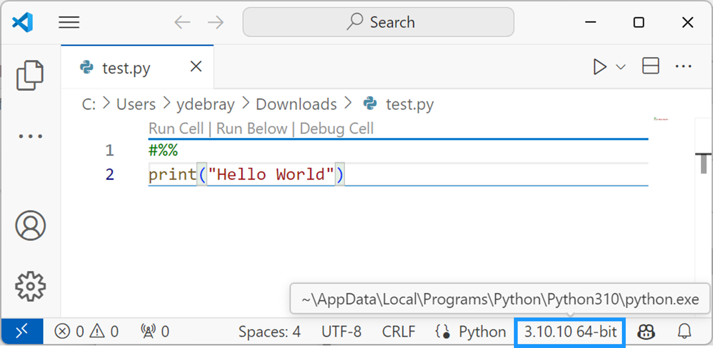

V1.2 – January 2025

Code open-sourced under MIT License

[https://github.com/yanndebray/programming-GPTs](https://github.com/yanndebray/programming-GPTs/)

*"Scaling AI applications is no small feat, but Programming GPTs makes it approachable. The book provides an excellent deep dive into retrieval-augmented generation and the challenges of leveraging vector databases like Weaviate for real-world use cases. A must-read for developers and architects alike." – Bob van Luijt, CEO of Weaviate*

*"With Programming GPTs, the complexities of large-scale vector search become approachable and actionable. The book offers a clear roadmap for solving real-world challenges in embedding-based indexing—essential reading for anyone serious about leveraging LLMs in production." – Jerry Liu, Founder of LlamaIndex*

*To my wife, family and friends\
They give me the courage to change what can be changed*

---

# Preface

"The proper study of man is anything but himself, and it is through the study of language that we learn about our own nature." – J.R.R. Tolkien

Language is a foundation for humanity. It is through language that we have elevated ourselves, from the silence of nature. First we existed, then our essence was granted by a Voice. We shared with one another. We started telling each other stories, sometimes simply relaying information, sometime making things up. We elaborated ideas, started reasoning about them, turning them into plans. A sound became words – letters, semantics, lexicons – words transformed into writings, writing into books, books into cultures, cultures into civilizations. Leading us all the way to the current digital age, with the inter-connected-net of articles, blogs, images, videos. All this content that started to feed machines, eager to learn.

Ever since the release of an apparently harmless chatbot application, we have observed an acceleration in the development of language modeling. Artificial intelligence has marked a new epoch in our relationship with language. These models, built on the crunching of numbers by the largest supercomputers in the world, have enabled computers to understand and generate human language with unprecedented accuracy. OpenAI's Generative Pre-trained Transformers are at the forefront of this revolution, demonstrating the extraordinary potential of AI to augment human capabilities.

This book is designed to equip you with the knowledge and skills needed to harness the power of GPTs, opening new horizons in the field of artificial intelligence. Whether you are a seasoned developer or a curious enthusiast, this practical guide will help you navigate the complexities of building AI agents, transforming your ideas into reality.

## Who is this book for

Ever heard of FOMO (Fear Of Missing Out)? I’ll try not to use FUD (Fear Uncertainty and Doubt) to sell you on GPTs. I’ll also try really hard not to use other TLAs (Three Letter Acronyms) in this book. Ok, I guess I’ll use one mainly: GPT. Wondering what this means, and how it could be relevant to your work? Then you might find what you need in this book.

I am assuming that you are *NOT an AI expert* (quite the opposite actually). If you already have some notions of what machine learning means, those might prove useful as we go deeper into describing what Generative AI is and how it differs from the previous waves of AI.

You are probably *tech savvy*, with likely some background in scientific or technical studies. Don’t worry, I won’t use gory mathematical equations to explain the concepts manipulated in the book. Instead, I’ll use concrete example of simple applications you can develop and tailor to your needs.

I’ll assume some *basic programming skills*, but no necessary experience with AI libraries like scikit-learn or pytorch. I would be good for you to have some basics of numeric, with libraries like numpy and pandas. Those should be easy to acquire. Overall you should have some appetite for coding, as it will make this experience much more enjoyable and give you a deeper understanding of the concepts.

## About the author

I graduated from college with a degree in mechanical engineering. Some of the course that I really got into involved numerical analysis with Maple and Mathematica. But it’s only after my studies, that I started to learn about data science and machine learning. This was 2013 and the rise of online courses, so like many, I followed the Stanford course from Andrew Ng on Coursera[^1].

I discovered myself a passion about technical computing, and joined a French start-up called Scilab. They were spinning off from the French research to build a consulting business around open-source software. It ended up being an exciting but challenging journey, with some new cloud products roll out and an acquisition a few years later. As I was learning more about the ways of open-source, I encountered another programming language, Python, that I fell in love with.

Then in the beginning of 2020, as the world was starting to lock down, I got a call from a company in Boston to work on the famous software MATLAB, the leader in technical computing. A few years later, here I am, more passionate than ever about numeric and eager to learn about its new forms, mostly called AI now. And the best way to learn is to teach. So, buckle up, and let’s go for the ride!

## What you will learn

The book is divided into 10 chapters, each covering a different topic and a different aspect of programming GPTs. The chapters are:

- *Chapter 1: Introducing GPTs***.** How they work and their evolution.

- *Chapter 2: OpenAI APIs.* In this chapter, you will learn how to use the OpenAI APIs, a simple way to create AI agents with GPT Models. You will start by learning how to create your own chatbot.

- *Chapter 3: Prompting, Chaining & Summarization.* In this chapter, you will learn how to engineer prompts, chain calls to a Large Language Model and use it to summarize texts, such as articles, books, or transcripts. You will use the OpenAI API together with the LangChain package to enhance GPTs.

- *Chapter 4: Vector search & Question Answering.* In this chapter, you will learn how to use embeddings and vector search as a way to retrieve informative answers to answer questions while quoting sources.

- *Chapter 5: Agents & Tools.* In this chapter, you will learn to build an Agent, called Smith, that has access to tools, such as getting the current weather. You will also learn how to use the Assistant API provided by OpenAI, and to extend their capabilities with tools to integrate GPTs with external services. This will be illustrated with the implementation of your own Code Interpreter, that can help you write and run code with GPTs.

- *Chapter 6: Speech-to-Text & Text-to-Speech.* In this chapter, you will learn how to use GPTs to transcript text from speech (such as Youtube videos) and synthetize speech from text (such as articles).

- *Chapter 7: Vision.* In this chapter, you will learn how to use GPTs to process and analyze images, such as mock-ups or drawings. You will learn how to use the Vision API, to perform various tasks with GPTs, such as text recognition, or video captioning.

- *Chapter 8: Dall-E image generation.* In this chapter, you will learn how to use Dall-E 2 & 3, which can create stunning and creative images from any text input. You will also learn how to use the outpainting, inpainting and variations APIs, which can complete or modify existing images.

- *Chapter 9: Deploying GPTs.* In this chapter, you will reuse what you have learned, and you will deploy your own GPTs. This will be made concrete with a small team of GPTs covering each one chapter of the book.

- *Chapter 10: Appendix.* In this chapter, you will find additional resources to keep up with the latest developments and innovations in the field of GPTs.

By the end of this book, you will have a solid understanding of how to program GPTs with OpenAI, and how to create amazing and useful applications with them. You will also have a deeper appreciation of the power and possibilities of GPTs, and how they can transform the world of natural language and beyond.

*Disclaimer*: I have used ChatGPT to help me write this book. But I would argue that the person who does not leverage AI to do her work is going to be left behind. Or said in a more politically correct tone: “You won’t be replaced by AI, but you’ll be replaced by someone using AI”. To read more about the potential of AI as an assistant, I’d recommend reading “Impromptu”.[^2]

## Setting up the Programming Environment

Setting up an effective programming environment is crucial for working with Generative Pre-trained Transformers (GPTs). This section will guide you through the necessary tools, libraries, and hardware requirements, followed by a step-by-step setup process.

### Initial Setup Guide

I’ll take as assumption that you are running on a Windows machine. Wherever there is a major difference in OS, I’ll try to make sure that I give explanations for the different platforms.

- Install Python

Ensure that Python (version 3.6 or later) is installed on your system. You can download it from the official Python website[^3].

- Set Up a Virtual Environment (optional)

This is a good habit if you don’t want to mess up completely your Python dev environment. This book will not leverage a lot of Python packages, so you might get away without it.

Using a virtual environment is recommended to manage dependencies. You can create a virtual environment using tools like *venv* or *conda*.

``` bash
python -m venv env
# Activate the environment
env\Scripts\activate
# On Linux or Mac: source env/bin/activate
```

- Install Packages

Here are a few python packages[^4] that will be used throughout the book:

``` bash
pip install openai langchain transformers streamlit
```

*OpenAI-Python*[^5] is the official client provided by OpenAI for interacting with their GPT models. *LangChain*[^6] is useful for chaining language model calls and building complex applications. *Transformers*[^7] is a popular library for working with open-source AI models. *Streamlit*[^8] is a Python framework for creating and sharing beautiful, custom web apps.

- API Keys and Authentication (For OpenAI)

Obtain an API key from OpenAI by registering on their platform. Set up authentication by adding your API key to your environment variables or directly in your code (not recommended for production).

- Test Installation

Verify your setup by running a small script to interact with the OpenAI API. As of version 1.X of the OpenAI Python SDK, your code would look like this:

``` python
from openai import OpenAI
client = OpenAI(api_key = 'sk-XXXX')
res = client.completions.create(
  model="gpt-3.5-turbo-instruct",
  prompt="Say this is a test",
)
print(res.choices[0].text)
```

Run the script including the API key obtained in the previous step:

``` bash
$ python openai_setup.py
```

- Streamlit Basic Setup

Create a simple Streamlit app to test the setup:

``` python
import streamlit as st
st.title('GPT with Streamlit')
user_input = st.text_input("Enter some text")
if user_input:
    st.write("Your input was:", user_input)
```

Run the Streamlit app with the following command (not simply executing the script with Python):

``` bash
$ streamlit run streamlit_setup.py
```

### Setup the dev environment

I will be using VSCode as my Integrated Development Environment (IDE) for this book. It is a popular coding editor that provides a rich set of features for Python development, such as syntax highlighting, code completion, debugging, testing, and version control. VSCode is also highly extensible, with a large number of extensions available in the marketplace. Feel free to use your preferred IDE or text editor if you are more comfortable with it.

To setup VSCode for a Python project, you will need to install some extensions and configure some settings. Here are some extensions recommended for VSCode to apply the learnings of this book:

- Install the Python extension from the VSCode marketplace. This will enable syntax highlighting, code completion, debugging, testing, and other features for Python files.

- Install the Jupyter extension from the VSCode marketplace. This will allow you to create and edit Jupyter notebooks with the *.ipynb* extension in VSCode, as well as view and interact with the outputs of your code cells. You can also execute sections of a *.py* file interactively in a separate panel by run Python code in a Jupyter kernel and see the results inline. To create a Jupyter section in a .py file in VSCode, you can use the *\#%%* delimiter. To run notebooks or cells in a Jupyter kernel, you will need to install the *ipykernel* python package. If you haven’t installed it manually, a dialog will pop up the first time to install it for you

Here are some advice to get you started with Python in VSCode:

- Create a folder for your project and open it in VSCode. You can use the *File \> Open Folder* menu or the command palette (*Ctrl+Shift+P*) and type **Open Folder**.

- Configure VSCode to use the correct Python interpreter and linter. You can use the status bar at the bottom of the editor to select the interpreter, as shown in Figure 0-1. Alternatively, you can use the command palette and type **Python: Select Interpreter**.



*Figure 0‑1 Select Python interpreter in VSCode*

If you don’t want to maintain your dev environment locally, you can get started with a cloud development environment, like GitHub Codespace. This works really well with Streamlit, as a full online dev environment.[^9]

### Develop and deploy a web app with Streamlit

Streamlit is a Python framework that lets you create beautiful and interactive web apps in minutes, without any web development skills. You can write your app logic in pure Python, and Streamlit will handle the front-end for you. Streamlit apps are composed of widgets, charts, maps, tables, media, and custom components that you can arrange and update dynamically with a few lines of code. Streamlit also provides a live reloading feature that automatically refreshes your app whenever you change your code or data.

Streamlit works by running a local web server that serves your app to your browser. You can either run your app on your own machine, or deploy it to a cloud platform like Heroku, AWS or the Streamlit Cloud. Streamlit apps are based on a simple concept: every time the user interacts with a widget, such as a slider or a button, Streamlit reruns your Python script from top to bottom, and updates the app accordingly[^10]. This means that you don't have to worry about callbacks, state management, or HTML templates. You just write your app logic as a normal Python script, and Streamlit will take care of the rest.

[^1]:  <https://www.coursera.org/specializations/machine-learning-introduction>

[^2]:  <https://www.impromptubook.com/>

[^3]:  [www.python.org](http://www.python.org)

[^4]:  openai \>= 1.0 langchain \>= 2.0 streamlit \>= 1.34

[^5]:  <https://github.com/openai/openai-python>

[^6]:  <https://www.langchain.com/>

[^7]:  <https://huggingface.co/docs/transformers>

[^8]:  <https://streamlit.io/>

[^9]:  <https://blog.streamlit.io/edit-inbrowser-with-github-codespaces/>

[^10]:  <https://docs.streamlit.io/library/get-started/main-concepts#app-model>

---

[🏠 Home](README.md) | [Introducing GPTs ➡️](1_Introducing_GPTs.md)
