# 10. Appendix

## 10.1. More AI theory

### Machine Learning

Machine learning is a branch of artificial intelligence that enables computers to learn from data and experience, without being explicitly programmed for every possible scenario. Machine learning can be used to solve complex problems that are hard to codify with rules, such as image recognition, natural language processing, or recommendation systems.

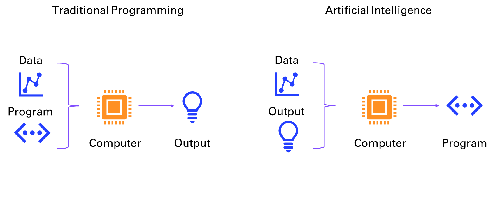

*Figure 10‑1 Traditional programming vs AI*

Machine learning can be broadly divided into two categories: supervised and unsupervised learning. Supervised learning is when the computer learns from labeled data, that is, data that has a known output or target. For example, in image recognition, the computer learns from images that are labeled with their corresponding categories, such as cat, dog, or car. The goal of supervised learning is to train the computer to predict the correct output for new data that it has not seen before.

Supervised learning can be further divided into two types: regression and classification. Regression is when the output is a continuous value, such as temperature, price, or speed. Classification is when the output is a discrete category, such as spam or not spam, positive or negative, or one of several classes.

Unsupervised learning is when the computer learns from unlabeled data, that is, data that has no known output or target. For example, in text analysis, the computer learns from documents that are not labeled with any topic or sentiment. The goal of unsupervised learning is to discover hidden patterns or structures in the data, such as clusters, outliers, or features.

Unsupervised learning can be mainly divided into two types: clustering and dimensionality reduction. Clustering is when the computer groups similar data points together based on some measure of similarity or distance, such as k-means, hierarchical clustering, or Gaussian mixture models. Dimensionality reduction is when the computer reduces the number of features or dimensions of the data, while preserving as much information as possible, such as principal component analysis, linear discriminant analysis, or autoencoders.

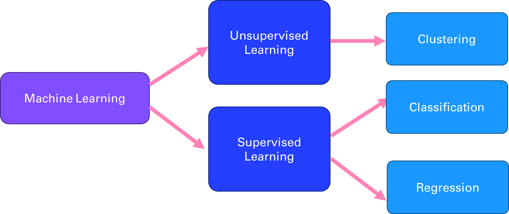

*Figure 10‑2 Different branches of Machine Learning*

### Deep Learning 

Deep learning is a branch of machine learning that uses neural networks with multiple layers to learn from data in a hierarchical manner. Neural networks are computational models that mimic the structure and function of biological neurons, which can process and transmit information through connections called synapses. Deep learning can handle complex and high-dimensional data, such as images, speech, or natural language, and perform tasks such as object recognition, speech recognition, natural language processing, or machine translation. Deep learning is inspired by the discoveries of neuroscience and cognitive science, and relies on advances in mathematical optimization, parallel computing, and big data.

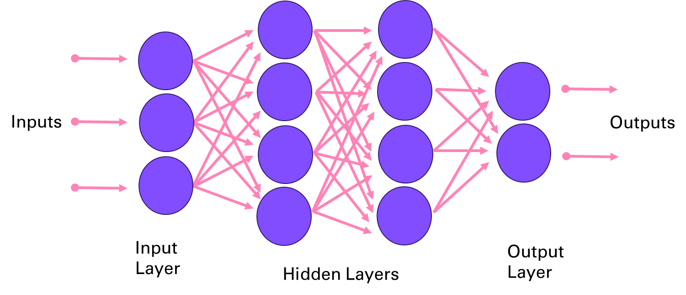

*Figure 10‑3 Deep Neural Network architecture*

A few key research breakthroughs made possible the innovations presented in this book, starting with *Yann LeCun et al* (1989) Backpropagation Applied to Handwritten Zip Code Recognition[^1]. This paper that is the same age as I introduced way back the potential of neural network for image processing, on the famous MNIST dataset[^2].

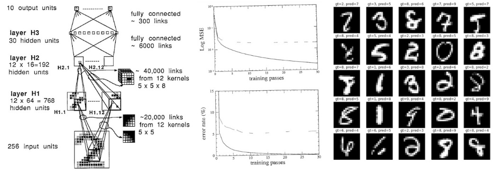

*Figure 10‑4 LeNet applied to digits recognition*

In the world of deep learning, TensorFlow and PyTorch are two of the most widely used frameworks. Both provide the tools needed to build, train, and deploy deep neural networks, but they differ in design philosophy and use cases.

- *TensorFlow*, released by Google in 2015 focuses on Flexibility and Scalability

- *PyTorch*, developed by Facebook seduces as Pythonic and Research-Friendly

### Natural Language Processing

Natural language processing (NLP) is the field of artificial intelligence that deals with understanding and generating natural language, such as text or speech. NLP has many applications, such as question answering, sentiment analysis, machine translation, summarization, dialogue systems, information extraction, and more. NLP faces many challenges, such as ambiguity, variability, complexity, and diversity of natural language.

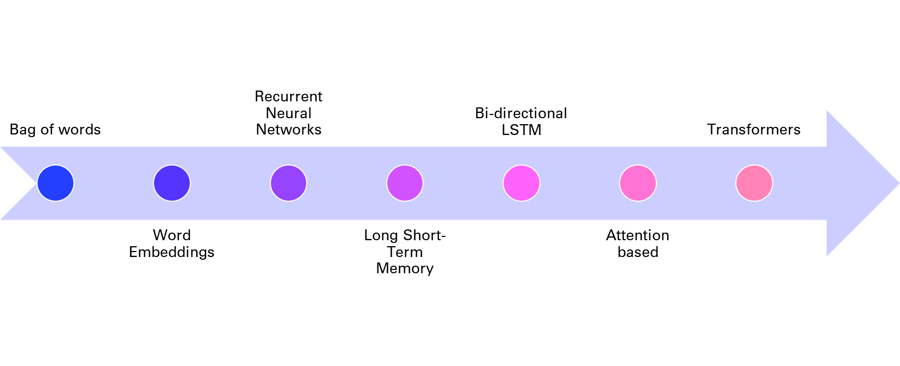

*Figure 10‑5 History of NLP techniques*

One of the key tasks in NLP is to represent natural language in a way that computers can understand and manipulate. Traditionally, this was done by using rule-based or statistical methods to extract features from words, such as their part-of-speech, syntactic structure, semantic role, or frequency. However, these methods often require a lot of human effort and domain knowledge and cannot capture the rich and dynamic nature of natural language.

To overcome these limitations, deep learning methods have been developed to learn distributed representations of natural language, also known as embeddings, from large amounts of data. As mentioned in chapter 4, embeddings are vectors that encode the meaning and usage of words or sentences in a low-dimensional space, and can be used as input or output for various NLP tasks. Embeddings can capture the semantic and syntactic similarities and relationships between words or sentences, and can also adapt to new domains and languages.

One of the first methods to learn word embeddings was the bag-of-words model, which represents a document as a vector of word frequencies, ignoring the order and context of words. The bag-of-words model is simple and efficient, but it suffers from sparsity, dimensionality, and lack of semantics. To address these issues, neural network models such as word2vec and GloVe were proposed to learn word embeddings from the co-occurrence patterns of words in large corpora, using techniques such as skip-gram and negative sampling. These models can learn more expressive and dense word embeddings, but they still treat words as independent units, ignoring their morphology and compositionality.

To account for the sequential and hierarchical structure of natural language, recurrent neural networks (RNNs) were introduced to learn sentence or document embeddings from word embeddings. RNNs are neural networks that process sequential data by maintaining a hidden state that captures the history of previous inputs. RNNs can learn long-term dependencies and generate variable-length outputs, making them suitable for tasks such as language modeling, machine translation, or text generation. However, RNNs also face some challenges, such as vanishing or exploding gradients, difficulty in parallelization, and sensitivity to noise.

To improve the performance and stability of RNNs, variants such as long short-term memory (LSTM) were developed to introduce gates that control the flow of information in the hidden state. These gates can learn to remember or forget relevant or irrelevant information over time and can handle long-term dependencies better than vanilla RNNs. LSTM have achieved state-of-the-art results on many NLP tasks, such as machine translation, speech recognition, or sentiment analysis.

However, even LSTM have some limitations, such as the inability to model long-range dependencies beyond a fixed window, the sequential nature of computation that limits parallelization, and the lack of attention mechanisms that can focus on relevant parts of the input or output. To overcome these limitations, a new paradigm of neural network models was proposed, based on the concept of transformers.

### Transformers

You might be wondering what’s happening under the hood of a GPT model. Let’s dive into the different parts of the model architecture discussed in chapter 1. Figure 10-5 shows the components of generative pre-trained transformers:

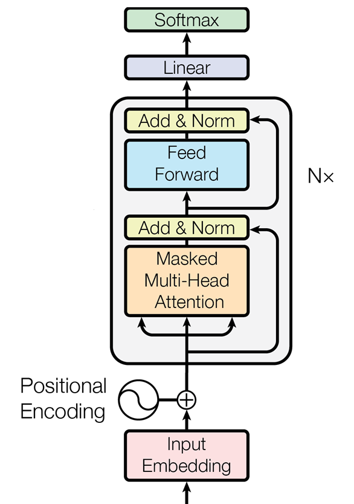

*Figure 10‑6 Architecture of a transformer as introduced in the paper “Attention Is All You Need”*

#### Input Preprocessing: From Words to Vectors

The preprocessing of the input text proceeds in three steps:

1.  *Tokenization:* Turning the words into numbers

2.  *Embedding:* Compressing the numbers into a dense vector representation

3.  *Positional Encoding:* Storing the position of the words in the sentence

Each step - from tokenization to embedding to positional encoding - plays a critical role in enabling the model to interpret text. Let's take a closer look at these preprocessing steps and their importance in making sense of how GPT models parse their input.

##### Tokenization 

AI models like GPTs cannot directly understand or process raw text as humans do. Computers only understand numbers. The first step (not shown in Figure 1-7) is breaking down the text into smaller units called *tokens*. These tokens typically represent words, subwords, or even characters, depending on the tokenization strategy. The tokenization step converts the input text into a sequence of tokens.

##### Embedding

Once tokenized, each token is then transformed into a dense vector of numbers. This process is called embedding. An *embedding* is a learned representation of the tokens in a continuous vector space where semantically similar tokens are closer together. This numeric representation is what the model actually processes.

##### Positional encoding

Unlike traditional models, transformers (like GPT) do not have a built-in sense of the order of tokens in a sequence. To provide this information, *positional encoding* is added to the token embeddings. This encoding incorporates information about the position of each token in the sequence, allowing the model to understand the order and relationships between tokens over different positions.

#### Decoder Block: Attention (Plus Compute) Is All You Need

The core of GPT is a stack of decoder blocks, each composed of two main layers, attention and feed forward, as well as addition and normalization layers completing the two main layers.

The decoder blocks are repeated N times (96 decoder blocks for GPT 3) as displayed on Figure 10-5 to form the main building blocks of the transformer architecture.

##### Attention

GPT uses a variant of attention known as *causal* or *masked* attention. This type of attention ensures that when generating a token, the model can only attend to previous tokens and not future ones. This is crucial for autoregressive generation, where each token is predicted based on the preceding tokens.

To capture different aspects of the input sequence, the model employs *multiple attention heads* that operate in parallel. Each head focuses on different parts of the input sequence, allowing the model to learn multiple representations of the sequence's information. The outputs from all the heads are then combined and passed on to the next layer.

##### Feed forward

After the attention mechanism comes a layer of pure compute. The output is passed through a feed-forward network, typically a multi-layer perceptron (MLP). This layer applies a non-linear transformation to the data, allowing the model to capture complex patterns and relationships within the data. The feed-forward network operates independently on each position, meaning it processes each token separately but consistently.

##### Addition and Normalization

After the multi-head attention and feed-forward layers, the output is combined with the input to that layer, symbolized by the link skipping these layers in Figure 1-7. This addition helps in retaining information from earlier layers, mitigating the vanishing gradient problem, and making it easier for the network to learn.

Following the addition step, normalization helps keep the training process stable and efficient by preventing large shifts in the input distributions as the model learns, which could otherwise disrupt or slow down learning.

#### Output Postprocessing: Back to Words, with some Probabilities

Once GPT models process input text through multiple layers of transformation and understanding, they need a way to translate their internal representations back into readable words or tokens. These final sets of layers are where abstract vector-based representations from the model's hidden layers are transformed into probabilities that guide token selection. The postprocessing steps involve passing the model's output through a linear layer and softmax function, which together assign probabilities to each possible token in the vocabulary, determining the most likely continuation of the text.

##### Linear layer

The output from the final decoder block is passed through a linear layer, which maps the high-dimensional representation of each token back to the size of the vocabulary. This step produces a raw score (logits) for each possible token in the vocabulary, indicating how likely each token is to appear next in the sequence.

##### Softmax function

Finally, the logits are passed through a softmax function, which converts them into probabilities. The softmax function ensures that the output values are between 0 and 1 and that they sum to 1 across the vocabulary. The token with the highest probability is selected as the model's output, representing the most likely next token in the sequence.

This architecture remains surprisingly very similar since the original transformers paper. One notable difference is the application of the layer norm before the attention mechanism in more recent transformers.

## 10.2. More LLMs: open-source and local alternatives

### Mistral

Mistral AI[^3] is a French startup that created an open-source LLM competitive with GPT-3.5 in about 1 year and with a team of 20 engineers. Setting aside the Frenchmanhood, I find this very impressive. The members of the founding team were previously employed at Google DeepMind and at FAIR (Facebook AI Research) working on important projects like the Llama model from Meta.

In only a few hours, I’ve been able to port my first three applications to be working with the Mistral API (la Plateforme):

- Chat

- Summarization

- Q&A with vector search

To get started with the API, you can use the python client[^4]:

```
```

Here is how you can convert some of your code from OpenAI to MistralAI:

``` python
from mistralai import Mistral
model = "mistral-tiny"
client = Mistral(api_key=api_key)
m = [{'role': user, 'content': 'What is the best French cheese?'}]

chat_response = client.chat.complete(
    model=model,
    messages=m,
)
print(chat_response.choices[0].message.content)
```

```
It is subjective to determine the "best" French cheese as it depends on personal preferences. Some popular and highly regarded French cheeses are:
1. Roquefort: A blue-veined cheese from the Massif Central region, known for its strong, pungent flavor and distinctive tang.
2. Comté: A nutty, buttery, and slightly sweet cheese from the Franche-Comté region, made from unpasteurized cow's milk.
3. Camembert de Normandie: A soft, Earthy, and tangy cheese from the Normandy region, famous for its white mold rind.
```

…

### Ollama

Download Ollama[^5] on your laptop and select the open-source LLMs you want to serve up locally:

``` bash
$ ollama run llama3:8b
pulling manifest
pulling 6a0746a1ec1a... 100% ▕████████████████████████████████████████████████████████▏ 4.7 GB
pulling 4fa551d4f938... 100% ▕████████████████████████████████████████████████████████▏ 12 KB
pulling 8ab4849b038c... 100% ▕████████████████████████████████████████████████████████▏ 254 B
pulling 577073ffcc6c... 100% ▕████████████████████████████████████████████████████████▏ 110 B
pulling 3f8eb4da87fa... 100% ▕████████████████████████████████████████████████████████▏ 485 B
verifying sha256 digest
writing manifest
removing any unused layers
success
```

Once you successfully retrieved the weights of the model (here 4.7Gb for the 8B Llama3 model), you can start interacting with the command line:

```
>>> Send a message (/? for help)
```

You can also use the Ollama Python client[^6] to build local LLMs applications, as an alternative to OpenAI:

``` bash
pip install ollama
```

Depending on your laptop resources (CPU, GPU and RAM) you might have a very slow response compared to what you are used to with GPT-3.5 or 4.

``` python
import ollama
response = ollama.chat(model='llama3:8b', messages=[
  {
    'role': 'user',
    'content': 'Hello world',
  },
])
print(response['message']['content'])
```

You can also stream the response and observe the throughput latency:

``` python
import ollama
stream = ollama.chat(
    model='llama3:8b',
    messages=[{'role': 'user', 'content': 'Why is the sky blue?'}],
    stream=True,
)
for chunk in stream:
  print(chunk['message']['content'], end='', flush=True)
```

This kind of setup can be useful for batch workflows where you want to process sensitive information without having to share it with a web service.

## 10.3. More Applications

### Image cropper

To create variations in chapter 8, you first need to crop the input image to the right shape (e.g. 512x512). Here is an app[^7] that enables you to interactively crop images.

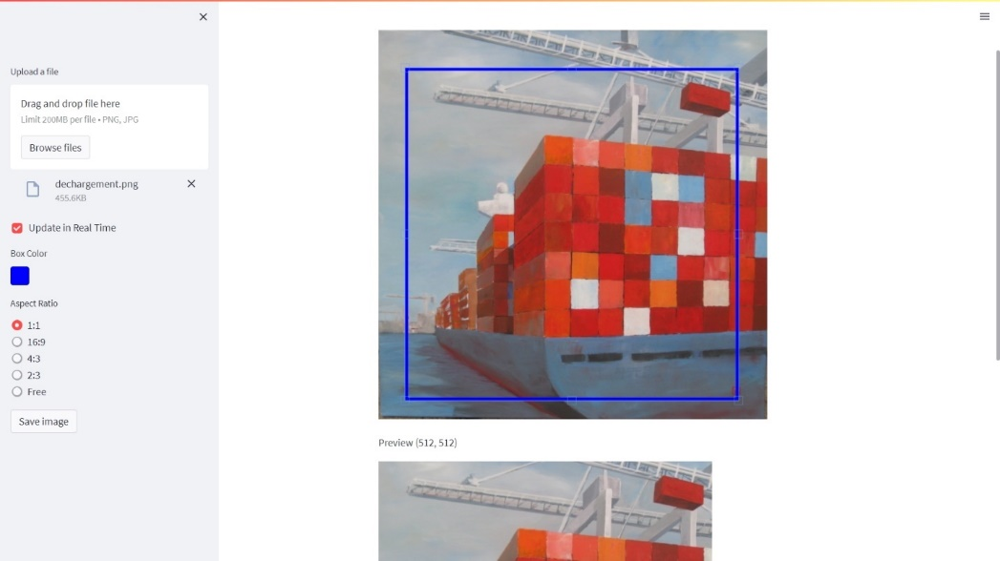

*Figure 10‑7 Image Cropper app*

You can simply crop the image programmatically as long as you know the location of your top left pixel.

``` python
import PIL
im1 = PIL.Image.open('../img/dechargement.jpg')
left=0
top=0
right=512
bottom=512
im2 = im1.crop((left, top, right, bottom))
im2.save("../img/dechargement_cropped.jpg")
im2
```

The resulting image can then be used to generate variations like in chapter 8.

``` python
import io
from IPython.display import Image

image_bytes = io.BytesIO()
im2.save(image_bytes, format='PNG')

response = openai.images.create_variation(
  model="dall-e-2",
  image=image_bytes,
  n=1,
  size="512x512"
)
image_url = response.data[0].url
print(image_url)
Image(url = image_url)
```

|          Before           | After                      |
|:-------------------------:|----------------------------|
|  |  |

This use case has a particular emotional meaning for me as this painting is hanging in my living room and was authored by my godmother who I love dearly. Seeing a new take on her creative work is lightning a thousand lights in my heart (this expression isn’t AI generated, it really is how this makes me feel).

### Video Analyzer

Post process Andrej amazing videos. For example:

Andrej Karpathy \[1hr Talk\] Intro to Large Language Models <https://www.youtube.com/watch?v=zjkBMFhNj_g>

- Download the Youtube video

``` python
from pytube import YouTube
video_id = "zjkBMFhNj_g"

url = f'https://www.youtube.com/watch?v={video_id}'  

yt = YouTube(url)

video_path = yt.streams.get_highest_resolution().download()
```

You can use a package called MoviePy to extract images from the video:

``` python
from moviepy.editor import VideoFileClip
time = 42
clip = VideoFileClip(video_path)
clip.save_frame(f"frames/frame_{time}.jpg", t = time)
```

To select manually frames from a Youtube video, I’ve created the following app: <https://video-analyzer.streamlit.app/>

- Extract/crop area of the picture (semi-manual process)

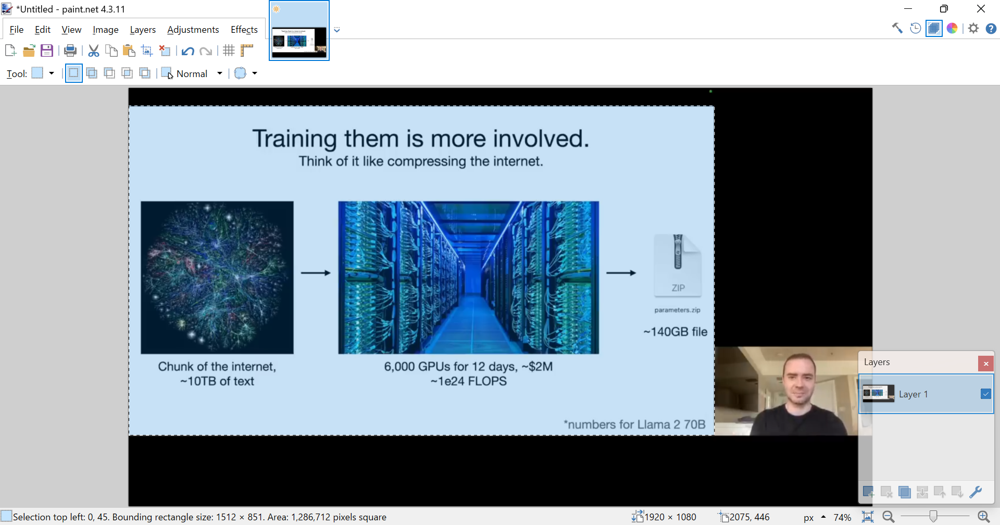

*Figure 10‑8 Manual cropping with Paint.NET*

I took a printscreen of the bottom left corner information and ask the Code interpreter to *write python code to crop the following selection*:

```
Selection top left: 0, 45. Bounding rectangle size: 1512 x 851
```

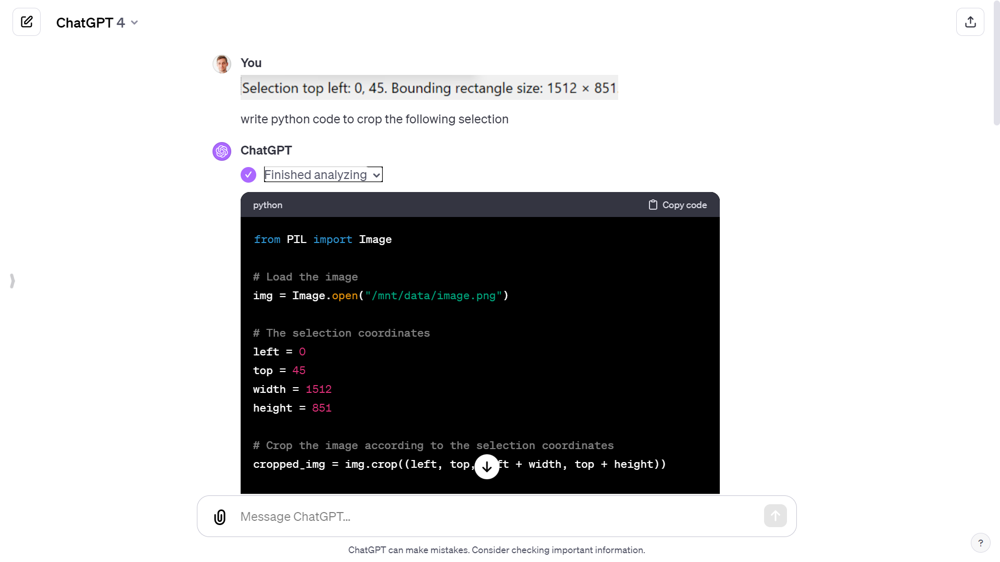

*Figure 10‑9 Generate code from ChatGPT to crop image*

``` python

left = 0
top = 45
width = 1512
height = 851

cropped_img = img.crop((left, top, left + width, top + height))

cropped_img_path = f"cropped_frames/cropped_frame_{time}.png"
cropped_img.save(cropped_img_path)
```

- Extracted the audio

``` python
from moviepy.editor import VideoFileClip


video = VideoFileClip(video_path)

audio = video.audio


audio_path = f'./{video_title}.mp3'
audio.write_audiofile(audio_path)
```

- Breakdown into chapters

Finally, I used the GitHub copilot chat panel to breakdown the audio file into chapters (from the chapter structure of the Youtube video):

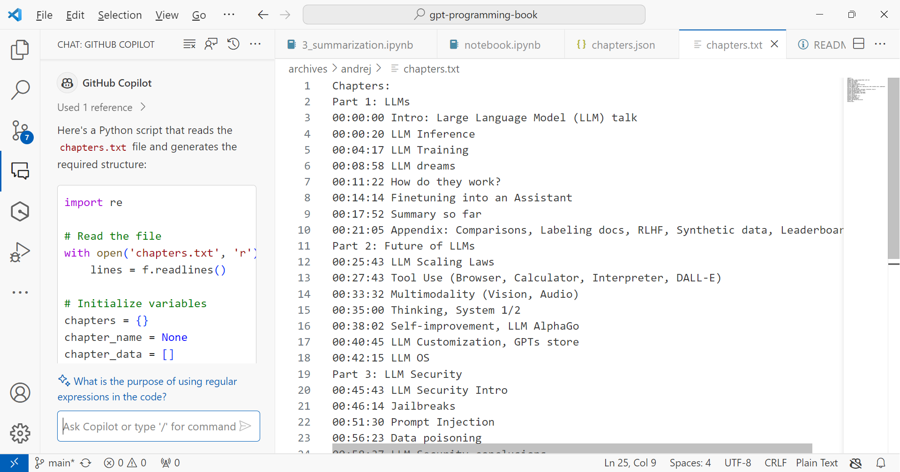

*Figure 10‑10 Chapter structure of the Youtube video*

### Movie search and recommendation engine

In April 2023, Andrej Karpathy[^8], one of the founding members of OpenAI and former Director of AI at Tesla, shared this fun weekend hack, a movie search and recommendation engine: [awesome-movies.life](https://awesome-movies.life). Here is my version of it:


*Figure 10‑11 Movie search and recommendation engine app*

Even though Karpathy did not share the code, Leonie – developer advocate at Weaviate reimplemented it[^9], using a vector database instead of simply storing embeddings as numpy arrays. So, this is where I took my inspiration from. It is an ideal last project to make sure that you master the notions in this book.

## 10.4. More copilots

### Microsoft copilot

As I am thinking about what to write in those next few lines, a little icon appears on the left of the empty line in Word. If I hover over it, it informs me that I can use Alt+I as a shortcut to summon the assistant:

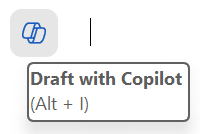

Figure 10‑12 Microsoft copilot icon

And if I click on it, I can see that an edit text box appears to await my prompt instructions.

This is a new feature that allows me to write with the help of an AI assistant. The assistant can suggest sentences, paragraphs, or even entire documents based on my input and preferences. I can also ask the assistant questions, give commands, or request feedback. For example, I can type:

- Write a chapter about X.

- Summarize the main points of this document.

- Check my grammar and spelling.

The assistant will try to respond to my requests as best as it can, using the information from the document or the internet. The assistant can also generate tables, charts, images, or other types of media if I ask for them.

(By the way the previous lines have been generated, and I did only modify about 30% of it, including removing the inexact facts.)

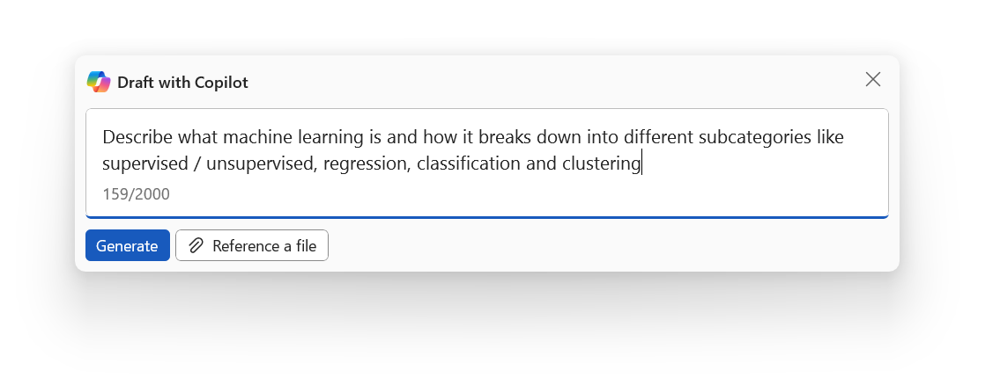

*Figure 10‑13 Inline chat in Microsoft Word*

You have now copilot integrated into most of the Microsoft products. I find them more or less useful, but those capabilities will likely evolve as copilot gets more widely adopted.

### GitHub copilot

GitHub copilot is probably the most useful copilot in my mind, as it turned me into a better coder.

You can start with a prompt if you have a clear idea of what you want to develop.

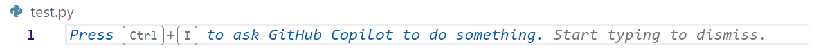

*Figure 10‑14 Press Ctrl+I*

If not, you can dive in the code, and add comments along the way to give hints to copilot on what you want to do next:

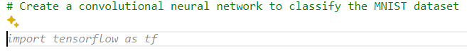

*Figure 10‑15 Autocomplete based on a comment*

All you have to do next is to enter Tab if you are satisfied with the code completion suggested. If not you can hover over the code to see if there are other proposition

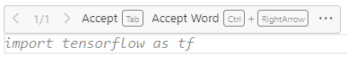

*Figure 10‑16 Tab to accept completion*

You can play with the tab and escape keys as the code get’s written for you.

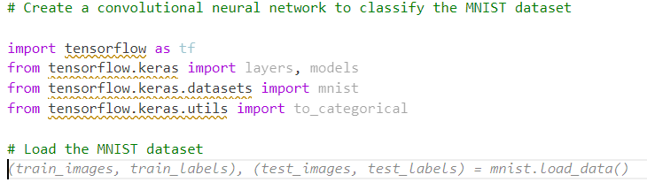

*Figure 10‑17 Coding one tab at a time*

I can assure you that this significantly reduces the cognitive load for me (especially because I’m not a professional coder). And I’m even learning a ton along the way. Before copilot, I would Google “How to code X in Python” and spend hours finding the right tutorial or forum post that solves a problem close to mine. Then I would still have to interpolate to my context.

This use case of LLMs generating code is for me by far the most valuable one, and it was enough to fuel my motivation to learn more about GPTs in 2023 and write this book in 2024.

[^1]:  <http://yann.lecun.com/exdb/publis/pdf/lecun-89e.pdf>

[^2]:  <http://yann.lecun.com/exdb/mnist/>

[^3]:  <https://mistral.ai/>

[^4]:  https://github.com/mistralai/client-python

[^5]:  <https://ollama.com/>

[^6]:  <https://github.com/ollama/ollama-python>

[^7]:  <https://github.com/turner-anderson/streamlit-cropper>

[^8]:  <https://karpathy.ai/>

[^9]:  Recreating Andrej Karpathy’s Weekend Project — a Movie Search Engine <https://towardsdatascience.com/recreating-andrej-karpathys-weekend-project-a-movie-search-engine-9b270d7a92e4> - <https://github.com/weaviate-tutorials/awesome-moviate>

---

[⬅️ Deploying GPTs](9_Deploying_GPTs.md) | [🏠 Home](README.md)
