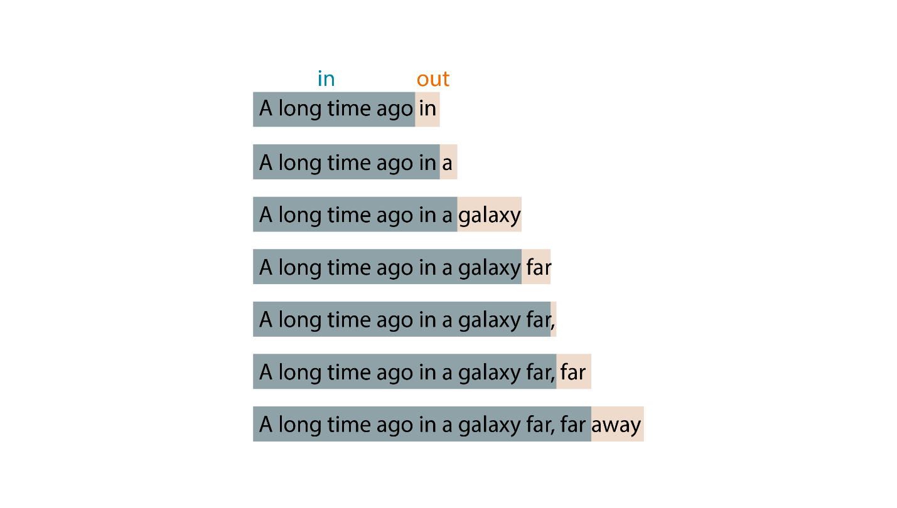
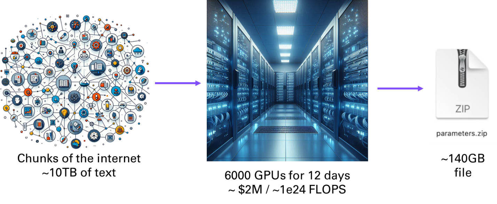
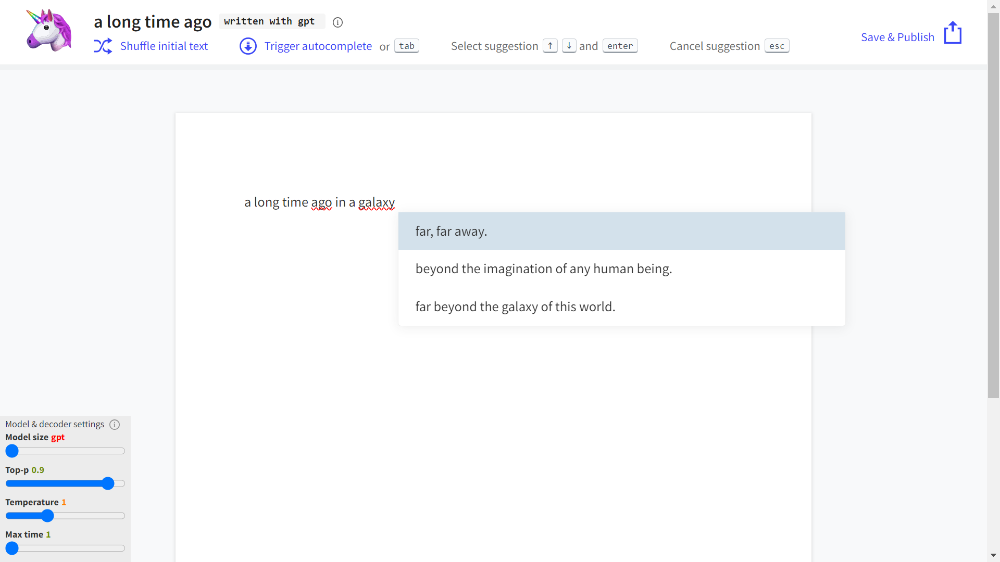
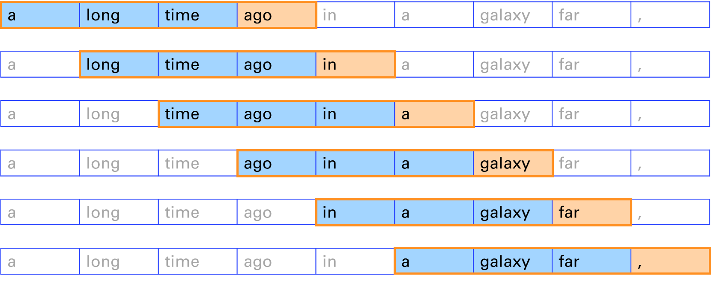
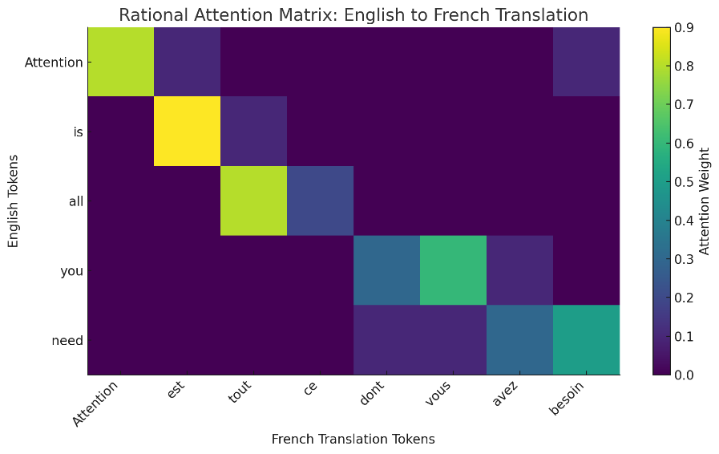
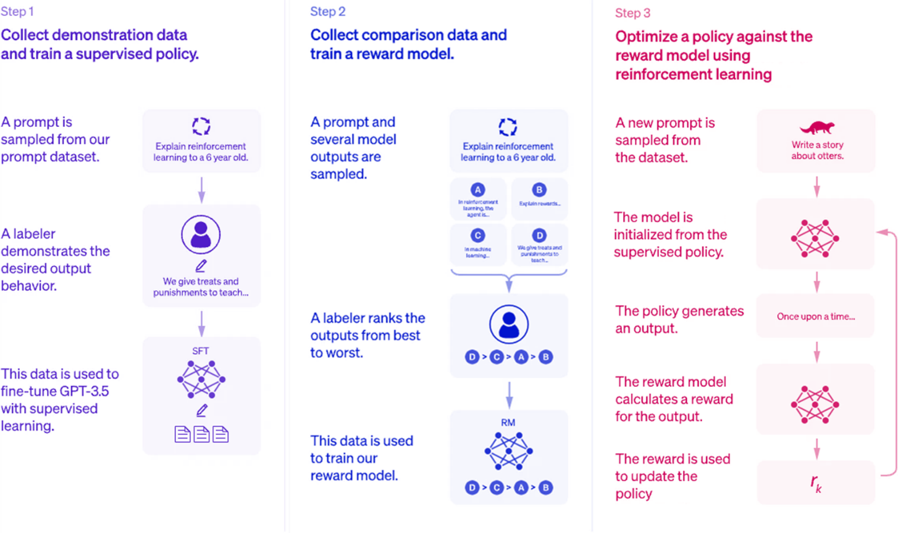
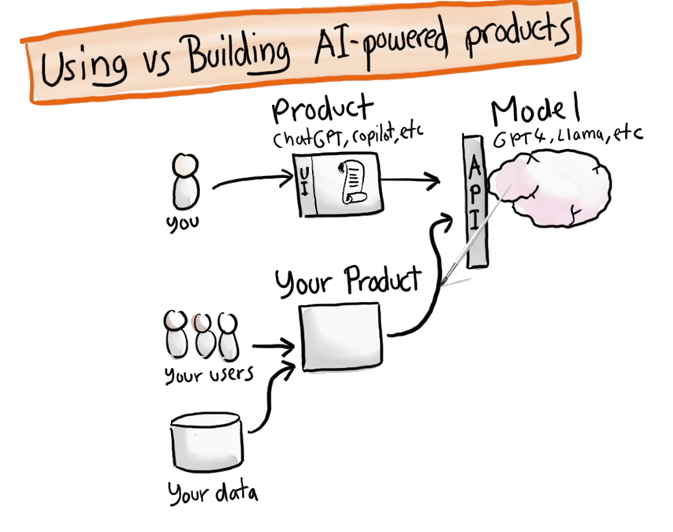

# 1. Introducing GPTs

Let’s start with a bit of theory. If you’re reading this book, I can assume you have a basic math and science education, and some programming experience. I don’t want to go too deeply into the different dimensions of large language models (LLMs), generative AI (genAI), and artificial intelligence (AI) either. My goal is to provide enough necessary background so that you can apply AI to your concrete applications. Figure 1-1 is a simple illustration of the relationships among these three concepts.


*Figure 1‑1 Levels within AI*

## 1.1. Large Language Models Are Next-Word Predictors

*Large language models* (LLM) are neural networks - mimicking the structure of the human brain - that can process and generate natural language texts based on a given input, such as a word, a phrase, or a prompt. LLMs operate word by word, based on the probability of each word being the most likely next word, kind of like the autocomplete function on your phone. Figure 1-2 shows an example of how an LLM might predict (output) the next word given an input of words.



*Figure 1‑2 Next word prediction*

Given the input *A long time ago*, an LLM might generate the output *in a galaxy far, far away*. It works like this:

1.  To generate the first word *in*, it uses only the input *A long time ago*.

2.  To generate the second word *a*, it uses the input plus the first word it just generated: *A long time ago + in*.

3.  To generate the third word, it uses the input plus the first word and the second word, and so on.

By working this way, after being trained on many texts and learning from the patterns and structures of natural language, an LLM can generate coherent and fluent texts of its own. This process is based on statistics and probabilities, as were former generations of AI models.

This kind of model is sometimes referred to as autoregressive. *Autoregressive* is a term that describes a model that predicts the next output based on the previous inputs as well as subsequent outputs from each iteration. Such a model assumes that the current value of a variable depends on its past values. It’s a little bit like how you might be able to guess the next word in a sentence if someone paused while speaking. Autoregressive models are widely used for applications other than text generation, such as time series forecasting and speech synthesis.

An LLM can also perform various natural language understanding tasks, such as answering questions, summarizing texts, or extracting information. LLMs can be seen as general-purpose language engines that can handle multiple tasks and applications with minimal supervision. As you’ll learn later in this chapter, GPT models are only one kind of LLM, developed by OpenAI in 2018. Since then, other prominent commercial and open-source alternatives have been released, such as the Llama models from Meta, Gemini from Google, Claude from Anthropic, the Mistral models, and others.

**<u>/!\\</u>** LLMs are not by nature assistants. If you prompt them with the beginning of a sentence, they will by default try to complete the sentence. They won’t try to make sense of the sentence or answer it as if it were a question. This is a fundamental shift that ChatGPT introduced by fine-tuning OpenAI’s GPT 3 model to perform question answering in the form of a chatbot.

LLMs are trained on massive amounts of text data, usually *trillions* of words from the internet (hence the term *large*), and from that training they learn to capture the statistical patterns and structures of natural languages in their parameters (generally in *billions*). You will discover in the next sections how this training process works. One way to think about LLMs is to consider them as a compression of internet knowledge. If you look at a model with 70 billion parameters (each represented as two bytes) and download it to your machine, you would have a 140 GB file (including the parameters). This represents a compression ratio of roughly 100:1. For state-of-the-art models like GPT-4, those numbers are off by a factor of 10 at least. Figure 1-3 tries to capture this idea.



*Figure 1‑3 LLMs can be said to compress the Internet*

LLMs kept growing larger and larger. Something quite remarkable and somewhat unexpected happened when LLMs reached a certain scale: some new properties started to emerge. I’ll talk more about the characteristics of these emergent properties when we look at the architecture of GPT models.

Table 1-1 should give you a sense of how LLMs have grown larger over time, using the GPT family of models to illustrate.

| **Model** | **Dataset size (billions of tokens)** | **Model size (billions of parameters)** |
|----|----|----|
| GPT 1 | 1-2 | 0.11 |
| GPT 2 | 10-20 | 1.4 |
| GPT 3 | 300 | 175 |
| GPT 4 | 10,000 | ??? (est. 1,800) |

*Table 1‑1 Size of the different generations of GPT models*

## 1.2. Generative Pretrained Transformers: Building Blocks of Language Intelligence

GPT stands for generative pre-trained transformer. The term refers to a family of LLMs created by the company OpenAI. Like all LLMS, GPTs are trained on massive amounts of text data from the web, such as Wikipedia articles, news stories, blog posts, books, and more. They learn to capture the patterns and structures of natural language, such as grammar, syntax, semantics, and style.

However, and perhaps confusingly, the term *GPTs* (plural) now refers to more than just a model—it refers to AI agents. An *agent* is a software program that can interact with its environment and perform specific tasks, such as answering questions, writing summaries, or composing emails. A GPT agent is built on top of a GPT model, using its language generation capabilities to produce responses to user requests. For example, a GPT agent can act as a chatbot, a search engine, a content writer, or a personal assistant.

In this book, you will explore the world of GPTs, both as models and as agents. You will learn how they work, how they are trained, and how they are used in various applications. You will also learn how to build your own GPT agents, using the powerful and easy-to-use OpenAI GPT APIs. These APIs allow you to access the state-of-the-art GPT models, such as GPT-4, without having to worry about the technical details of running and maintaining them. You will also learn how to enhance the capabilities of GPT models by granting the GPT agents access to tools.

But first let’s look a little more closely at the three words contained in the term *GPT*.

### Generative

*Generative* models can create new data from existing data. For example, given an image, a generative model can produce another image that is similar but not identical to the original one. Similarly, given a text, a language model can produce another text that is related but not identical to the original one. Since GPT-4, the line between language models and other kinds of generative models is blurring, as GPT-4 supports text as well as image and sound (both as input and output).

Going back to language models, here is an example of text generation with the first GPT model that was released (now called GPT-1):

``` python
from transformers import AutoTokenizer, OpenAIGPTLMHeadModel
tokenizer = AutoTokenizer.from_pretrained("openai-community/openai-gpt")
model = OpenAIGPTLMHeadModel.from_pretrained("openai-community/openai-gpt")
input_ids = tokenizer.encode("A long time ago in a galaxy far", return_tensors="pt")
outputs = model.generate(input_ids, max_length=42, do_sample=True)
text_generated = tokenizer.decode(outputs[0])
print(text_generated)
```

a long time ago in a galaxy far off, we were working on the same quantum project, the same concept of the universe where we were supposed to go. i think there was a long period of time

**<u>/!\\</u>** With sampling (do_sample=True), the model doesn't always pick the most likely token. Instead, it randomly *samples* from the distribution of possible next tokens according to their probabilities. Sampling introduces an element of randomness, allowing for more diverse and creative outputs.

To get a sense of how the first GPT model works, you can use the Write With Transformer app available at *transformer.huggingface.co*. Simply select the model you would like to take for a spin, and you will be able to type in a prompt and see the model generate text based on it, as shown in Figure 1-4.



*Figure 1‑4 Write With Transformer example*

### Pre-trained

GPT models have been *pre-trained* on massive amounts of text from the internet and can produce coherent and diverse responses on almost any topic. They can also perform various tasks, such as answering questions, summarizing texts, generating images, and more.

This process of pre-training involves two main stages:

1.  Pre-training a base model

2.  Fine-tuning an assistant model

Table 1-2 summarizes the GPT training process.

|  | **Pre-training** | **Fine-tuning** |
|----|----|----|
| Dataset | Raw internet: Trillions of words. Low quality, large quantity | Demonstrations: ~10-100K Ideal assistant responses (prompt, response) written by contractors. High quality, low quantity |
| Model | Base model | Assistant model |
| Method | Self-supervised next word prediction | Supervised on manually labeled data |
| Compute | 1000s of GPUs, months of training | 1-100 GPUs, days of training |

*Table 1‑2 GPT training pipeline*

Language contains impressive inherent properties, such as structure and syntax, context and semantics, intrinsic hierarchical information, predictability and sheer richness in the data. The big breakthrough enabled by generative models was due to the fact that they could learn language constructs by *self-supervision*. Traditional supervised learning requires a curated set of inputs and outputs. Generative models on the other end simply train their parameters by predicting the last word of a sequence with a sliding window, as shown in Figure 1-5.



*Figure 1‑5 Self-supervision with a sliding window*

The emergence of properties that I mentioned appeared with the scaling up of the size of the neural network and the dataset on which it was trained. As Aristotle said, “The whole is greater than the sum of its parts.” This topic raises the question of *artificial general intelligence* (AGI), a hypothetical type of AI that would possess the ability to perform any intellectual task that a human can. Such a concept is well beyond the scope of this book. Here we will focus on more practical aspirations: to teach you how to leverage GPTs to assist you in your daily tasks.

### Transformers

GPT models use a special kind of neural network architecture called a *transformer*, introduced in 2017 in a paper by Ashish Vaswani et al called “Attention Is All You Need”[^1]. Similarly to previous generations of neural networks, like convolutional or recurrent neural networks, transformers are composed of many *layers* of artificial neurons that are activated in a specific order during the training and prediction phases depending on their arrangement. For instance, recurrent neural networks (RNNs) maintain a memory of the previous state of information processed by the network, which is useful to predict future elements of a sequence. But as the name of the paper hints, the new network architecture introduced with the transformers departs from previous approaches to convert sequences to sequences, by focusing on a key ingredient, called the *attention mechanism*.

Attention provides contextual understanding, which enables the model to consider the meaning of each word in a sentence, regardless of its position. This means each word's encoding in the neural network is influenced by every other word in the sentence, allowing for a more nuanced understanding of language. The attention mechanism equips the model with an efficient method for processing text. Unlike RNNs where the words are processed sequentially, transformers process all words in a sentence simultaneously, leading to significant gains in computational efficiency. For example, given a sentence in English, transformers can learn to translate it to French. In Figure 1-6, you can observe the more verbose translation in French. The lighter yellow positions in this attention matrix capture the translations of the words (attention is the same word in French).



*Figure 1‑6 Simple translation from English to French*

The original transformer from the paper consists of two parts: an encoder and a decoder[^2]. The *encoder* takes the input text and transforms it into a numerical representation, i.e. a series of numbers mapping each part of the sentence, capturing the meaning and context of the input. The *decoder* takes the numerical representation and generates the output text. This is particularly useful for translation.

GPT models, like most LLMs nowadays, are decoders-only because this type of network is particularly well-suited for text completion. By focusing solely on the decoder, GPT models can streamline their architecture to better specialize in understanding and generating language. Decoders-only architectures reduce complexity because they focus on one task (next-word prediction) and don't require the additional overhead of encoders. This makes them easier to scale and optimize for large datasets and extensive training without needing to balance encoder-decoder interactions. Since decoders-only models are trained autoregressively (predicting the next token based on previous ones), this setup naturally lends itself to highly parallelized and efficient training.

Transformers have become the dominant architecture for LLMs, and can be described as general-purpose machines, being expressive, optimizable, and efficient:

- *Expressive:* They can model complex relationships and patterns in data

- *Optimizable*: Their ability to handle complexity is not compromised by the fact that transformers can be trained on large amount of data

- *Efficient*: The training and prediction can be parallelized on graphics cards.

## 1.3. Evolution of GPTs 

The development of Generative Pre-trained Transformers (GPTs) has been a revolutionary journey in the field of artificial intelligence and natural language processing. This section delves into the fascinating progression of GPT models, from their humble beginnings to the powerful language models we see today. We'll explore the key milestones, technological advancements, and the increasing capabilities that each iteration brought to the table. By understanding this evolution, we can better appreciate the current state of GPT technology and glimpse into its potential future applications.

### Life BC (Before ChatGPT) 

As I’ve mentioned, the first GPT model (later called GPT-1) was released in 2018 by OpenAI, along with a paper called [“Improving Language Understanding by Generative Pre-training.”](https://openai.com/index/language-unsupervised/)[^3] This first model had 117 million parameters, trained on a large corpus of text from the web, called WebText, which contained about 40 GB of data. As its parameters and architecture were released with an open-source license, it enabled researchers to fine-tune it to specific tasks (such as text classification and sentiment analysis) with relatively little new data, leveraging its pre-trained knowledge.

However, GPT-1 had some limitations. For example, it could not handle long-term dependencies, because of the small context window at the core of its relatively shallow attention layer. That meant it could not remember or use information that had appeared earlier in the text. It also struggled with factual consistency, which means that it could not verify or correct the information that it generated. Moreover, it sometimes produced offensive or biased texts, which reflected the quality and diversity of the data that it was trained on.

To address these issues, OpenAI released GPT-2 in 2019. The accompanying paper was titled [“Language Models are Unsupervised Multitask Learners”](https://openai.com/index/better-language-models/)[^4] highlighting the emerging ability of this model to perform tasks on natural language such as question answering, without the need for supervised training on task-specific datasets. This new set of capabilities came from its 1.5 billion parameters, which was more than 10 times the size of GPT-1. It was also trained on a much larger corpus of text, called WebText2, which contained about 570 GB of data.

GPT-2 improved significantly on the performance and quality of GPT-1 and achieved state-of-the-art results on many natural language benchmarks. It also demonstrated a remarkable ability to generate coherent and engaging texts on a variety of topics and styles, such as news articles, essays, stories, and reviews. However, GPT-2 also raised some ethical and social concerns. Due to its high level of realism and versatility, GPT-2 could potentially be used for malicious purposes, such as spreading misinformation, impersonating others, or generating fake content. Therefore, OpenAI decided to release GPT-2 gradually, starting with a smaller version of 124 million parameters and then releasing larger versions over time, along with some tools and guidelines to help researchers and developers use GPT-2 responsibly and safely.

The big breakthrough came with GPT-3 and the appropriately titled paper [“Language Models are Few-Shot Learners”](https://arxiv.org/abs/2005.14165)[^5], which was released in 2020 by OpenAI. With a staggering 175 billion parameters, more than 100 times the size of GPT-2, it was trained on an enormous corpus of text, called WebText3, which contained about 45 TB of data. One of the key features of GPT-3 was its ability to perform tasks with little to no task-specific training, known as *zero-shot* or *few-shot learning*. This means GPT-3 could understand and respond to prompts in a meaningful way, even if it hadn’t been explicitly trained on that task.

GPT-3 was not only a powerful language generator, it was a general-purpose artificial intelligence system that could learn to perform any task that can be described in natural language. For example, given a prompt like *Write a summary of this article*, or *Create a slogan for this company*, or *Solve this math problem*, GPT-3 could generate appropriate and accurate responses by using its vast knowledge and understanding of language and the world. And to guide the model in the type of results you were expecting, you could provide one or several examples as part of the prompt.

### ChatGPT and Alignment

GPT-3.5, also known as ChatGPT is an improved version of GPT-3 that focuses on enhancing its conversational skills. ChatGPT is designed to be a friendly and engaging chatbot that can chat with humans about any topic and provide relevant and interesting information as well as tell jokes. It closely follows a paper from early 2022 called ["Training language models to follow instructions with human feedback”](https://openai.com/index/instruction-following/)[^6], introducing instructGPT and paving the way for the revolution that was to come…

ChatGPT is based on the same architecture and data as GPT-3, but with some key differences. ChatGPT aimed to fix what is called alignment. *Alignment* is the process of encoding human values and goals into large language models to make them as helpful, safe, and reliable as possible. Essentially, it builds in guardrails so that the AI doesn’t embed the biases that can be found on the internet.

How did OpenAI achieve this? ChatGPT was initially meant only as a research project to demonstrate the potential of *reinforcement learning from human feedback* (RLHF). This involved leveraging some of the early work of OpenAI in the field of reinforcement learning that is often associated with robotics or games like chess, go, or Mario.

In traditional reinforcement learning, an agent learns to make decisions by interacting with an environment to maximize cumulative reward. The agent explores actions, observes results, and receives rewards or penalties, which guide future actions. In RLHF, human feedback supplements or replaces the predefined reward signals. Human evaluators observe the agent’s actions and provide feedback on their quality or appropriateness. This feedback helps shape the reward function. Figure 1-7 illustrates the three steps of the RLHF process as implemented by OpenAI.



*Figure 1‑7 Humans are participating at different steps of the fine-tuning of ChatGPT*

Here are the steps explained for the alignment of ChatGPT through reinforcement:

1.  *Collect demonstration data and train a supervised policy:* Human feedback is used to label the training data. This is used to fine-tune the model.

2.  *Collect comparison data and train a reward model:* Humans rate the output of the model from the previous step. This is captured in a reward function.

3.  *Optimize a policy against the reward model:* This is now an iterative process without manual human input where the two previous steps are brought together to improve alignment.

### GPT-4 and beyond

In March 2023, OpenAI released GPT-4, marking another significant leap in the capabilities of large language models. GPT-4 introduced several key advancements.

GPT-4 demonstrates enhanced logical reasoning and problem-solving skills, performing better on complex tasks that require multi-step thinking. GPT-4 outperforms GPT-3.5 by scoring in higher approximate percentiles among test-takers as displayed in table 1.3 where we see the comparison of the performance of the two models.

|                  | GPT-3.5 | GPT-4 |
|:----------------:|---------|-------|
| Uniform Bar Exam | 10th    | 90th  |
| Biology Olympiad | 31st    | 99th  |

*Table 1‑3 GPT-4 surpasses GPT-3.5 in its advanced reasoning capabilities*

Unlike its predecessors, GPT-4 can process both text and images as input. This allows it to analyze, describe, and reason about visual information in addition to text. This ability is called *multimodality*.

On top of this new modality, audio support came in May of 2024 and earned the model a new nickname, GPT-4o where “o” stands for “omni”

Finally, on a more practical note, GPT-4 can handle much longer inputs, with versions gradually able to process up first 8k tokens, then 32k tokens, to finally reach an astonishing 128k tokens in a single prompt. Later in the book, you will learn more about the capabilities of GPT-4.

In September 2024, a new series of models called o1 was introduced. Those models spend time *thinking* before answering to a question, making them more efficient in complex reasoning tasks, like science and programming. A good use case for this generation of models is to engineer a comprehensive prompt to prime the pump on the development of a new complete app.

## 1.4. Building Your Own GPT

OpenAI coined the term *GPTs* to extend their offerings beyond the established GPT models to GPT agents. This came as a response to the growing trend of developing custom ChatGPT implementations. This move essentially positioned OpenAI as a platform for developers to deploy AI agents. At the same time, they offered a low-code approach to building custom GPTs (by programming without coding), lowering the barrier of entry for non-coders.

This book describes different alternatives for programming GPT agents offering rich options and details (see Table 1-4). A strong ecosystem boomed in 2023 from this rich set of options around different opinionated approaches to tackle this challenge. Here is a high-level table that compares what can be done via the ChatGPT app vs the API.

|  | Custom GPTs (via ChatGPT) | Assistants (via the API) |
|:--:|----|----|
| Creation Process | No code | Requires coding for integration |
| Operational Environment | Located in ChatGPT | Can be integrated into any product or service |
| Pricing | Included in ChatGPT on Plus/Team/Enterprise plans | Billed based on usage of different Assistant features |
| User Interface | Built-in UI with ChatGPT | Designed for programmatic use; can use playground for visualization |
| Shareability | Built-in ability to share | No built-in shareability |

*Table 1‑4 Developing GPT agents through low-code vs API integration approach*

Some [very clever programmers like Andrej Karpathy](https://www.youtube.com/watch?v=kCc8FmEb1nY)[^7] have even gone so far as to build such elaborate AI models from scratch, or based on open-source implementations such as the Llama family of models (from Meta). This isn’t the approach I take in this book, as it is way more involved and requires very deep AI and programming skills.

Instead, this book adopts an approach somewhere in-between the low-code and high-code options to build your own AI-powered applications. For this we will attempt to just get the right level of understanding of how those GPTs are operating by becoming familiar with the OpenAI application programming interface (API).

To explain the need for the API, you can consider the cases of using vs building AI-powered products. In the next chapter, you will learn how to use the OpenAI API.



*Figure 1‑8 using vs building AI-powered products*

[^1]:  Attention is all you need: <https://arxiv.org/abs/1706.03762>

[^2]:  Encoder-decoder architecture: Overview <https://www.youtube.com/watch?v=zbdong_h-x4>

[^3]:  <https://openai.com/index/language-unsupervised/>

[^4]:  <https://openai.com/index/better-language-models/>

[^5]:  Language Models are Few-Shot Learners: <https://arxiv.org/abs/2005.14165>

[^6]:  InstructGPT paper: <https://openai.com/index/instruction-following/>

[^7]:  Let's build GPT: from scratch, in code, spelled out. <https://www.youtube.com/watch?v=kCc8FmEb1nY>

---

[⬅️ Preface](0_Preface.md) | [🏠 Home](README.md) | [OpenAI APIs ➡️](2_OpenAI_APIs.md)
