# 2. OpenAI APIs

In this chapter you will discover the main APIs that OpenAI provides to interact with their GPT models. You will learn how to develop and deploy your first chatbot app with Streamlit. As an application of your learning, you will build your very first chatbot. It will look like this:

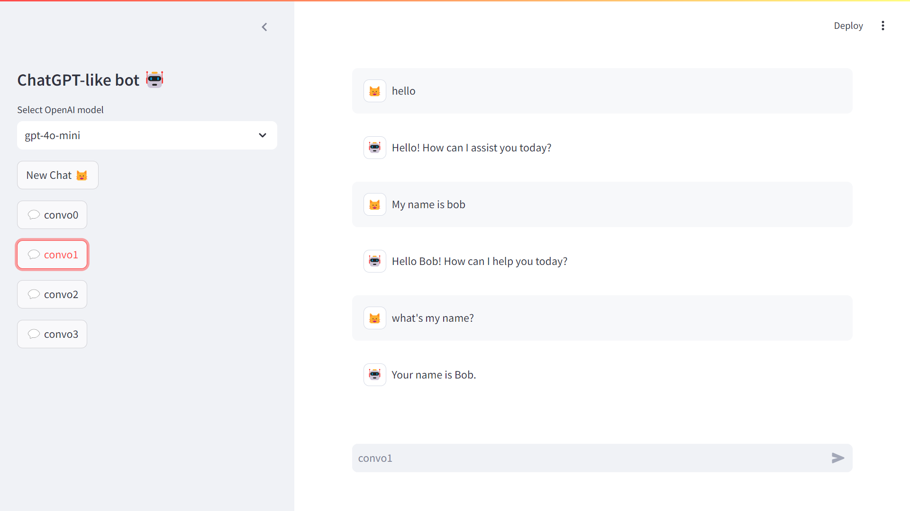

*Figure 2‑1 Your first chatbot app*

## 2.1. Quick tour of the OpenAI developer platform

First you will need to create an OpenAI account on their developer platform (*platform.openai.com*). Once you are logged in to your OpenAI account, the landing page of the developer platform will take you to a playground that enables you to get access to different kinds of models. The main kind of models are chat models on which I will focus for this chapter. But you will see other kinds of models in the rest of the book, like the Assistant and TTS (Text-To-Speech) models. Completion models are now considered legacy.

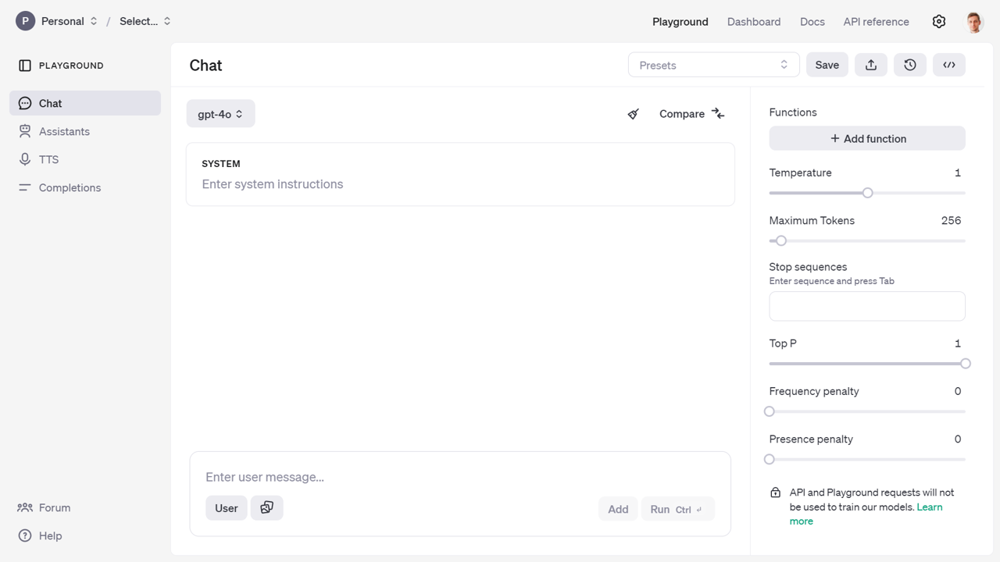

*Figure 2‑2 Play around in the playground and test the model APIs*

This will give you an experience close to the one you have with the ChatGPT web app. But from there you will be able to access more advanced parameters of the model and view the code necessary to replicate the call to the API from your own program. If you are lacking inspiration, and you don’t know where to start, you will find some prompt examples from the presets in the documentation[^1].

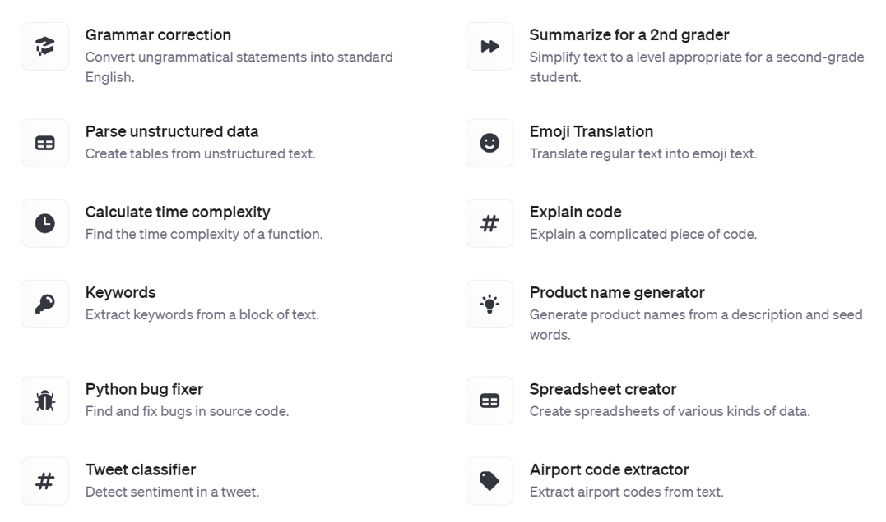

*Figure 2‑3 Prompt examples*

If you want to take a guided look at the documentation[^2] before trying anything or go lower level to the definition of the functions in the API reference[^3].

Finally you can also access a dashboard to access management services:

- *Assistants*: to create and manage your own assistant models

- *Fine-tuning*: to fine-tune your own models

- *Batches*: to manage your batch jobs

- *Storage*: to manage files and vector stores

- *Usage*: to give you a sense of your consumption of the OpenAI web services.

- *API keys*: to manage your API keys

**<u>/!\\</u>** As an important data privacy disclaimer, API and Playground requests will not be used to train OpenAI models. This isn’t the case of the public ChatGPT App, which by default can learn from users’ conversations.

## 2.2. Getting started with the chat completion API

### Authentication

Any call to the API needs to be authenticated with a key. You can find your API key in the *API keys* section of the dashboard. As a good practice for a SaaS application, you want it to take its configuration (including keys) from environment variables, like a 12-factor app[^4]. As a result, launching the app in development is not very practical because you have to set those environment variables yourself. There are two methods we recommend for storing your keys securely on your local machine.

The first method is storing your keys as environment variables in a *.env* file in the development phase, like this: OPENAI_API_KEY="sk-xxx". To load the environment variables, you will need to pip install python-dotenv. Add the following two lines of code in any of your python script:

``` python
from dotenv import load_dotenv
load_dotenv()  # take environment variables
```

What this does is reading key-value pairs from a *.env* file located at the root of your project and setting them as environment variables.

An alternative is to store your key as a variable OPENAI_API_KEY="sk-xxx" in a file *secrets.toml*. This type of file can be manipulated with a dedicated python package: pip install tomli. Since it will be used in the next section by Streamlit, save this file in a folder called *.streamlit/* and load it with the following command:

``` python
with open('.streamlit/secrets.toml','rb') as f:
    secrets = tomli.load(f)
```

This step won’t be necessary if you run a Streamlit app, as Streamlit will take care of loading the secrets from the *.streamlit/* folder automatically. But if you run in a python script or a jupyter notebook, you will need to perform one of those options to load the API key as environment variable before the next section.

**<u>/!\\</u>** Make sure that for both of those options you list the file/folder *.env* and *.streamlit/* in the *.gitignore* file to avoid sharing your secrets in your public github repo.

### Sending your first request to the OpenAI API with Python

This is what the first lines of code look like from the version 1.0 of the OpenAI Python SDK:

``` python
import openai
openai.api_key = "sk-XXXX"
m = [{'role': 'system', 'content': 'If I say hello, say world'},
    {'role': 'user', 'content': 'hello'}]
completion = openai.chat.completions.create(model='gpt-4o-mini',
                                            messages=m)
response = completion.choices[0].message.content
print(response) # world
```

The chat.completions endpoint of the API has several input parameters, but only two are required: models and messages.

- *Models*

OpenAI offers developers to utilize their models through a REST API, as well as through python and javascript libraries. These models are hosted on remote servers for easy querying both for prototyping and production use. Each model has distinct capabilities and pricing options. It’s crucial to understand that these proprietary models can’t be tweaked directly in code. However, you can fine-tune some on your unique data using the OpenAI API. However earlier models from OpenAI like GPT-2 aren’t proprietary. You can download GPT-2 from sources like Hugging Face or GitHub, but it is not available via the API. For this chapter and most of the book, we will use GPT-4o mini because it is the most cost effective model from the latest generation of OpenAI GPT Models.

**<u>/!\\</u>** The OpenAI python library is actually quite flexible and can also be used for other model providers, such as GitHub Models, or local LLMs served with Ollama.

- *Messages*

The first big mystery that was in the back of my mind when using the chatGPT web app, was: “Does it remember what I say?” The conversational format certainly makes you feel like it does. But by taking a look at the underlying API for chat completion, you will realize that there isn’t any memory in the system. All the context is passed each time to the service, that is stateless. This can be understood by taking a look at the transformer architecture in chapter 1, where the model can complete text and pay attention to the context, given that it fits into the context window. The messages parameter is a list of dictionaries[^5] that form the conversation history. Each message dictionary includes a role (either system, user, or assistant) and content, which contains the text of the message. This allows the model to understand the context of the conversation and generate relevant responses. Example:

"messages": \[

  {"role": "system", "content": "You are a scientist named Albert."},

  {"role": "user", "content": "Explain the theory of relativity."}\]

The first entry is a system prompt: it is going to serve as context for the rest of the conversation, forcing the chat to behave in a certain way. Some developers have found success in continually moving the system message near the end of the conversation to keep the model’s attention from drifting away as conversations get longer.

The list of messages can contain as many user and assistant exchanges as you want, as long as you do not exceed the model’s context window. The context window is the maximum number of tokens that the model can remember from the conversation history. If you exceed this limit, the model will start to forget the beginning of the conversation.

Additional parameters can be passed to the chat completion API (like max number of tokens, number of choices to generate, and stream option). Those will be addressed in the last section of the chapter.

## 2.3. Prices of the API

The prices[^6] have evolved quite a bit since the introduction of the ChatGPT API.\
As of the time of this writing (gpt-4o-2024-11-20):

<table>
<colgroup>
<col style="width: 23%" />
<col style="width: 37%" />
<col style="width: 39%" />
</colgroup>
<thead>
<tr>
<th style="text-align: center;"><p>model</p></th>
<th style="text-align: center;"><p>input price</p>
<p>($ per 1M tokens)</p></th>
<th style="text-align: center;"><p>output price</p>
<p>($ per 1M tokens)</p></th>
</tr>
</thead>
<tbody>
<tr>
<td style="text-align: center;"><p>gpt-4o-mini</p></td>
<td style="text-align: center;"><p>$0.150</p></td>
<td style="text-align: center;"><p>$0.600</p></td>
</tr>
<tr>
<td style="text-align: center;"><p>gpt-4o</p></td>
<td style="text-align: center;"><p>$2.5</p></td>
<td style="text-align: center;"><p>$10</p></td>
</tr>
</tbody>
</table>

*Table 2‑1 Prices of the API*

**<u>/!\\</u>** Make sure to check the latest prices of the API, and consider how you could be submitting your request as a *batch*[^7]. Responses will be returned within 24 hours for a 50% discount. If some of your input tokens are repeated across requests, they will be automatically *cached*[^8] giving you 50% discount compared to uncached prompts.

To give you a sense of the cost of using the API on a daily basis, here is a view over the month of May, where I spend the most of my time writing this book and developing the associated GPTs.

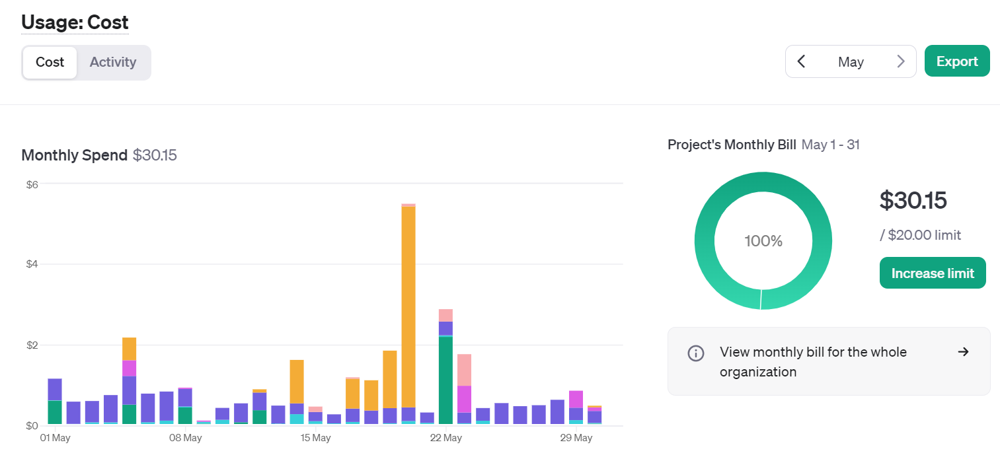

*Figure 2‑4 Cost of OpenAI services over the period of a busy month*

If you hover over the graphic, you can see the breakdown by service (image, audio, embeddings, …) or by model (3.5, 4o, …). The big spike mid-month was due to the Dall-E 3 service usage for over \$5 on 1 day.

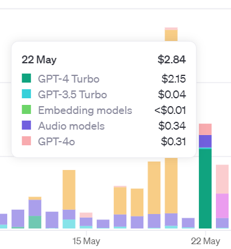

*Figure 2‑5 Breakdown of the cost per service*

You can add email alerts and set budget limits to control your spending. As I started integrating more AI into my apps over the year, I ended up creating new keys for each project, and even distributing keys to friends and colleagues:

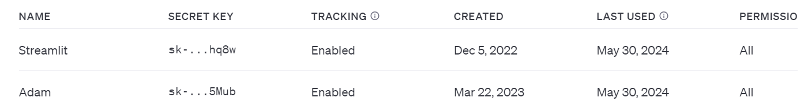

*Figure 2‑6 Table of active OpenAI keys*

This enabled me to have a finer grain control over the different projects including AI. You now have the ability to actually create a “project” that can contain members and have dedicated limits attached to it

## 2.4. Build your first chatbot app

In this section, you will learn how to build your very first chatbot application, leveraging the OpenAI APIs. It will serve as a foundation for the subsequent apps that will be built throughout the book. In the preface, you have discovered Streamlit, and why it is such an amazing framework for Python web applications. Now you will experience the basics of building such an application yourself. The resulting app is stored on GitHub in the file *chat_app.py*[^9], and I will walk you step by step through the development of such an app.

I will breakdown the development of the chatbot into the following steps:

1.  *Graphical components*: Define the basic user interactions with the app

2.  *Chat elements*: Display the chat conversation in the main area, and implement convenience functions to save and load the chat history in a sidebar

3.  *Session states*: Store the state of your app in a session variable to simplify the interaction schema

4.  *Response streaming*: Display the response as it is being generated

### Graphical Components

This part is going to focus more on the basics of Streamlit. You will leverage two types of text display (a title and a simple text), and more importantly an input field, in the form of a simple text input. You will see how by simply arranging those components in the natural ordering of the script, they will render in your web app in the same linear way, from top to bottom. Figure 2-7 represents the local serving of the app. 127.0.0.1 represents the localhost, and the default port is 8501.

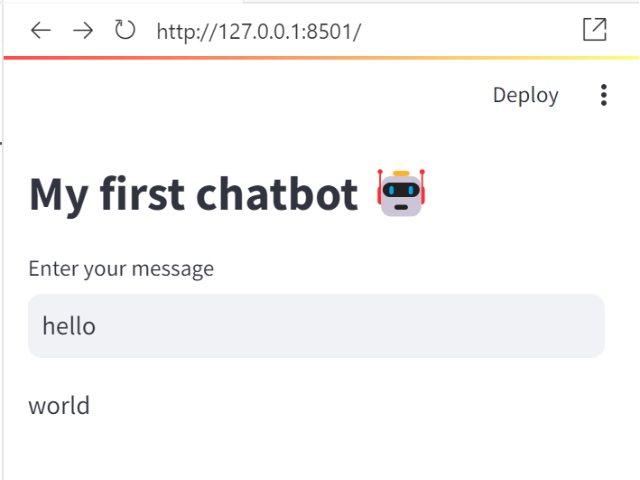

*Figure 2‑7 Simple chat user interface*

This is the code for the first chat Graphical User Interface in Streamlit:

``` python
import openai
import streamlit as st
openai.api_key = st.secrets['OPENAI_API_KEY']
st.title('My first chatbot 🤖')
m = [{'role': 'system', 'content': 'If I say hello, say world'}]

if prompt:
    m.append({'role': 'user', 'content': prompt})
    completion = openai.chat.completions.create(model='gpt-4o-mini',
                                            messages=m)
    response = completion.choices[0].message.content
    st.write(response)
```

As mentioned in the previous section about authentication, the API key is stored locally in a folder *.streamlit*. This way, Streamlit will know where to find your secrets, that are stored as a Python dictionary. A simple title will be rendered as a h1 heading. This is a simple way of informing your visitors what the app does. The fun starts with the function *text_input*, that displays a single-line text input widget. The magic operates by simply assigning the text output of this function to a variable (called prompt here). As we’ve seen in the previous section about the chat completion API, messages are passed as a list of dictionaries, and the user prompt is logically appended to the end of this list initialized at the top of our script. To serve up the app locally, use the streamlit command instead of simply running the script with python:

streamlit run chap2\2_2_first_chat.py

You can now view your Streamlit app in your browser.

Local URL: http://localhost:8501

Network URL: http://192.168.1.30:8501

If you change your source code and save it, you will see a message at the top right of the app, prompting you rerun the app as displayed in figure 2-8. Another convenient option is to select *Always rerun* to automatically take your changes into account every time you update your code.

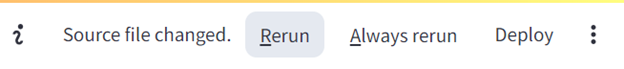

*Figure 2‑8 Rerun the app*

You can gradually increase the complexity of the app, by adding *radio* buttons to choose the model:

``` python
models_name = ['gpt-4o-mini', 'gpt-4o']
selected_model = st.radio('Select OpenAI model', models_name)
st.write(f'Selected model: {selected_model}')
```

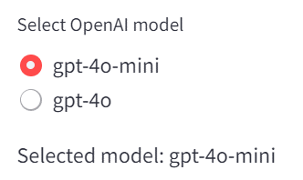

*Figure 2‑9 Model selection with radio buttons*

This other type of graphical component enables a finite number of choice options to be displayed for an exclusive selection of one only (unlike checkboxes that enable multiple choices). This component operates similarly to the selectbox that we will see later, but that hides the selection to only reveal the selected option.

Finally, another very important component for an app is a simple… button. In the following code, you will see how to condition sending you message with the boolean trigger of the button state.

``` python

if st.button('Send'):
    st.write(prompt)
```

Now that you have covered the basics of a Streamlit app, let’s look more at the behavior of a chatbot.

### Chat elements

In the app you developed in the previous section, the layout is linear and top down. This is the default rendering of a Streamlit app, following the flow of the python script. But to interact with a chatbot, you would expect the input to remain at the bottom of the page, and the messages to stack vertically to form a conversation.

Two new methods have been added in 2023 to facilitate the development of chat-based apps:

- *chat_message* lets you insert a chat message either from the user or from the assistant.

- *chat_input* lets you display a chat input widget at the bottom so the user can type in a message.

``` python
import streamlit as st
messages = [{'role': 'user', 'content': 'hello'},
            {'role': 'assistant', 'content': 'world'}]
if prompt := st.chat_input('Enter your message'):
    messages.append({'role': 'user', 'content': prompt})
for line in messages:
    if line['role'] == 'user':
        with st.chat_message('user'):
            st.write(line['content'])
    elif line['role'] == 'assistant':
        with st.chat_message('assistant'):
            st.write(line['content'])
```

As you can see from the structure of the code, the rendering of the messages will be done after a new message has been added to the list. But the layout of the app is special in this case, as the chat inputs shows up at the bottom of the page as shown in Figure 2-10 resulting from the code snippet above.

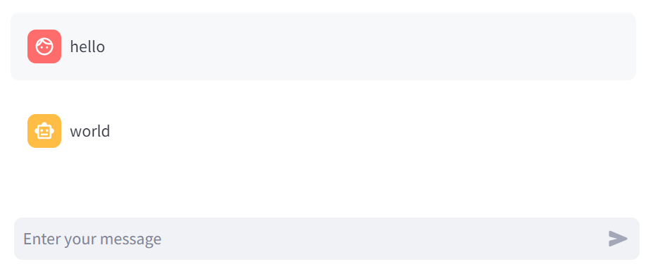

*Figure 2‑10 A basic chat dialog*

A similar result can be achieved in a simpler for loop:

``` python
for line in messages:
    st.chat_message(line['role']).write(line['content'])
```

In order to design the behavior of the app, without calling OpenAI each time, I’d recommend creating a dummy chat function:

``` python
import streamlit as st
import json

def dumb_chat():
    return "Hello world"
if prompt := st.chat_input():
    with st.chat_message('user'):
        st.write(prompt)
    with st.chat_message('assistant'):
        result = dumb_chat()
        st.write(result)
```

This is a good practice whenever you want to design an App based on an API, to first design the User Experience of the app with dummy functions. This function will then be replaced by the call to the OpenAI API when you are ready to implement and test the behavior with real responses:

``` python
def chat(m):
   completion = openai.chat.completions.create(
model='gpt-4o-mini',messages=m)
    response = completion.choices[0].message.content
    return response
```

In order to start building a log of conversations that can be saved and loaded, you can use the json library to save and load the conversation history:

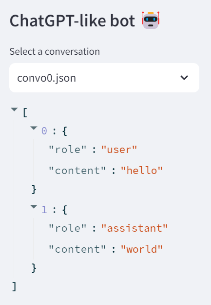

*Figure 2‑11 Sidebar with a conversation history*

This sidebar in Figure 2-11 will be loading an existing conversation, with a function called *load_chat*, as a dictionary for debugging:

``` python
def load_chat(file):
  with open(f'chat/{file}') as f:
    convo = json.load(f)
  return convo
st.sidebar.title('ChatGPT-like bot 🤖')
convo_file = st.sidebar.selectbox('Select a conversation', os.listdir('chat'))

convo = load_chat(convo_file)
st.sidebar.write(convo)
```

**<u>/!\\</u>** The sidebar is a useful component, as it enables to display widgets in a left panel that can be folded on a desktop screen. By default, it appears hidden on a mobile screen but can be toggled to cover the main area. It is a good place to display contextual information or input elements such as the conversation history, or additional parameters of the API like model selection.

Now let’s save the new elements of the conversation, with a function called *save_chat*:

``` python
def save_chat(convo,file):
  with open(f'chat/{file}','w') as f:
    json.dump(convo, f, indent=4)

if prompt := st.chat_input():
  # Append the text input to the conversation
  with st.chat_message('user'):
    st.write(prompt)
  convo.append({'role': 'user', 'content': prompt})
  # Query the chatbot with the complete conversation
  with st.chat_message('assistant'):
     result = chat(convo)
     st.write(result)
  # Add response to the conversation
  convo.append({'role':'assistant', 'content':result})
  save_chat(convo,convo_file)
```

You can implement other functions such as *add_message* and bring all of those functions together in the main script:

``` python
import streamlit as st
import json

def load_chat():
    with open('chat/convo0.json') as f:
        dummy = json.load(f)
    return dummy
def dumb_chat():
    return "Hello world"
def add_message(messages,role,content):
    messages.append({'role': role, 'content': content })
    return messages
messages = load_chat()
st.sidebar.write(messages)
if prompt := st.chat_input():
    with st.chat_message('user'):
        st.write(prompt)
    messages = add_message(messages,'user',prompt)
    st.sidebar.write(messages)
    with st.chat_message('assistant'):
        result = dumb_chat()
        st.write(result)
    messages = add_message(messages,'assistant',result)
    st.sidebar.write(messages)
```

The different functions introduced in this section are meant to provide convenience in the building of a chatbot app. They are not mandatory, but they will help you to structure your code in a more modular way. The main goal is to make the code more readable and maintainable, and to facilitate the debugging process.

### Session states

In the previous section, you have seen how to save and load a conversation. But you don’t really want to be writing to disk every element of our app that needs to store a state. So now is a good time to dig deeper into the execution model of Streamlit, and how to memorize the elements from the app. Streamlit reruns your script from top to bottom every time you interact with your app. Each reruns takes place in a blank slate: no variables are shared between runs. Session states[^10] is a way to share variables between reruns, for each user session. You have seen how to store messages as a list of dictionaries and append new messages to this list subsequently for the user and the assistant. In this section, you will see how to make use of Streamlit session state in order to store the conversation as illustrated in figure 2-12.

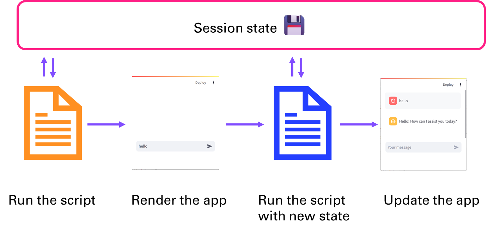

*Figure 2‑12 Store state for the duration of the session*

Creating a Streamlit app and opening it in a browser initiates what’s known as a session, which is a Python object that resides in memory on the back end server. A session lasts as long as the user has the browser tab open and there’s an active connection with the app’s back end, meaning that the app’s UI elements can interact with Streamlit’s server. Opening the app in a separate window or tab creates a separate session, ensuring users in different locations don’t impact each other’s experience. The session represents activity in the browser, while the session state captures and retains the current data from widgets and parameters for future use. I will go over how to effectively employ session state with your Streamlit app.

First you need to initialize the parameters of the session state:

``` python

if 'convo' not in st.session_state:
  st.session_state.convo = []
```

Then we append the content of the conversation to the session state:

``` python
if prompt := st.chat_input():
  # Append the text input to the conversation
  with st.chat_message('user'):
    st.write(prompt)
  st.session_state.convo.append({'role': 'user', 'content': prompt })
  # Query the chatbot with the complete conversation
  with st.chat_message('assistant'):
    result = chat(st.session_state.convo)
    st.write(result)
  # Add response to the conversation
  st.session_state.convo.append({'role':'assistant', 'content':result})
```

### Streaming response

Finally, one small thing is missing in order to have an app that looks and feels just like ChatGPT. We will modify the call to the openai chat completion API, by adding the parameter stream.

Setting stream = True in a request makes the model start returning tokens as soon as they are available, instead of waiting for the full sequence of tokens to be generated. It does not change the time to get all the tokens, but it reduces the time for first token for an application where we want to show partial progress or are going to stop generations. This can be a better user experience and a UX improvement so it’s worth experimenting with streaming.

``` python
def chat_stream(messages,model='gpt-4o-mini):
  # Generate a response from the ChatGPT model
  completion = client.chat.completions.create(
        model=model,
        messages= messages,
        stream = True
  )
  report = []
  res_box = st.empty()
  # Looping over the response
  for resp in completion:
      if resp.choices[0].finish_reason is None:
          # join method to concatenate the elements of the list
          # into a single string, then strip out any empty strings
          report.append(resp.choices[0].delta.content)
          result = ''.join(report).strip()
          result = result.replace('\n', '')        
          res_box.write(result)
  return result
```

Congratulations 🎉 You have created your first chatbot. If you assemble the learnings from the previous sections, you will be able to replicate the code in chat_app.py

## 2.5. Advanced parameters

Let’s look at a few additional parameters that you might want to tweak to adjust the result you are getting from the chat completion API. I will walk you through three main elements to take into account to achieve mastery in your AI applications:

- Max tokens and cost management

- Probabilities of the next token

- Temperature and sampling

### Max tokens and cost management

As you have seen in a section above, you have admin tools to manage your usage and the cost incurred for using the API. Another way to implement guardrails directly into your application is to count and limit tokens, sent to or produced by the GPT model.

Let’s digress for a moment in order to implement a simple cost management dashboard displayed in Figure 2-13 that might be useful for you in many of the apps you will bring to production (given that you meet a certain audience and popularity).

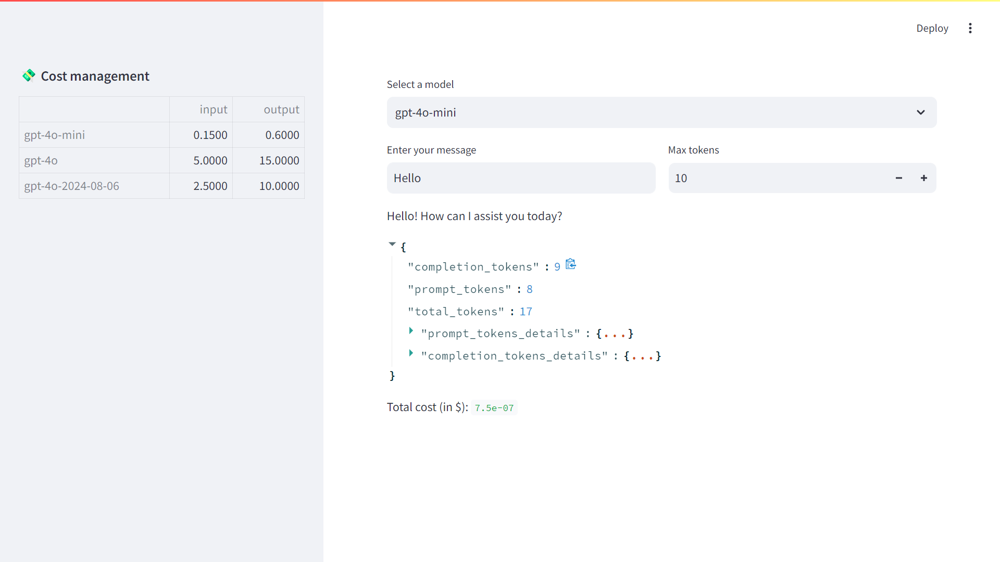

*Figure 2‑13 Bring in cost management as part of your application*

The table of the current cost per million tokens (input and output) for each OpenAI model is loaded from a simple spreadsheet, and given the model selected, the cost of the response to a simple ‘Hello’ is computed, and broken down into prompt (input) and completion (output). The response “Hello! How can I assist you today?” only cost me \$7.5e-07.

But if your app is consuming a large amount of prompts and subsequently generating long responses, you might want to consider throttling the chat completion by specifying the maximum number of tokens generated. In this example the limit is higher than the response, but if you play around with the Max tokens value, you will crop the response.

### Probabilities of the next token

As you have seen in the previous chapter, the autoregressive prediction of the response to a prompt proceeds by predicting successively the sequence of next tokens, following a probability distribution. You can actually access this distribution of output tokens by specifying the parameter logprobs=True when calling the API.

The top_logprobs parameter provides insight into the model’s decision-making process by returning the probabilities of the top n tokens considered at each step of generation, expressed along a logarithmic scale. These log probabilities can help you understand how confident the model is about its token choices and can be used for debugging, fine-tuning, or analyzing model behavior.

If you want to represent a probability between 0 and 1, you need to elevate this number with an exponential. Why not directly use the probability instead of the log to make the prediction you will ask. There are two main reasons why logprobs make token prediction faster and are easier for computers to work with.

1.  It’s cheaper for computers to do addition than it is to do multiplication. Figuring the next token is easier when you’re adding the log probabilities of each token, instead of multiplying their actual probabilities.

2.  Optimizing the log probability (logprob) is more effective than optimizing the probability itself - the gradient (the direction and rate of change) of the logprob tends to be smoother and more stable, making it easier to optimize during training.

The application in Figure 2-14 illustrates with a slider each probable next token. You can precise the number of probable tokens you want to display for each prediction.

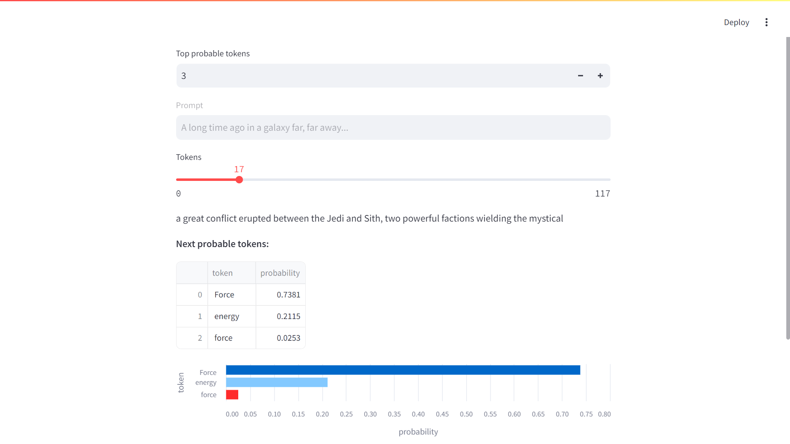

*Figure 2‑14 Probabilities for next tokens*

The most probable next token here is “Force” but it’s not necessarily the one that will be selected for the generation of the response. There are several reasons for this. Always choosing the highest probability can lead to repetitive or predictable text. Lower probability choices can introduce novel and interesting ideas. Finally, human writing often includes less-than-optimal word choices, making the text feel more natural.

**<u>/!\\</u>** logprobs can be used to implement an auto complete feature or assess the confidence for a classification problem like sentiment analysis[^11]

### Temperature and sampling

The temperature parameter controls the randomness of the output. A lower temperature (e.g., 0.2) makes the model's output more focused and deterministic, while a higher temperature (e.g., 0.8) results in more varied and creative responses.

An alternative to sampling with temperature, is the top_p parameter also called nucleus sampling, where the model considers the results of the tokens with top_p probability mass. So 0.1 means only the tokens comprising the top 10% probability mass are considered.

Figure 15 and 16 shows the impact of temperature and top_p on the next token probability distribution.

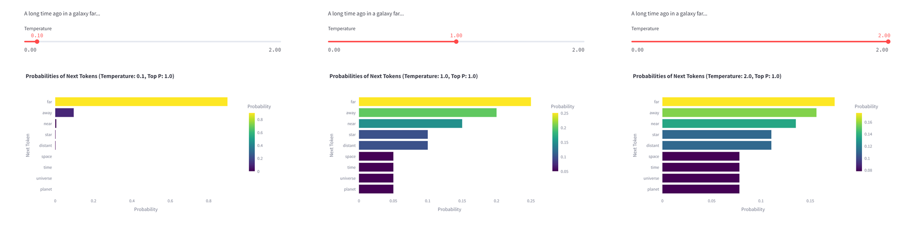

*Figure 2‑15 Impact of temperature on the probability of the next token*

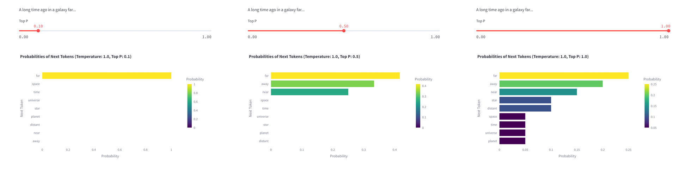

*Figure 2‑16 Impact of top_p on the probability of the next token*

[^1]:  Prompt examples: [<u>https://platform.openai.com/docs/examples</u>](https://platform.openai.com/docs/examples)

[^2]:  Doc: [platform.openai.com/docs](https://platform.openai.com/docs/overview)

[^3]:  API Reference: [platform.openai.com/api-reference](https://platform.openai.com/api-reference)

[^4]:  Methodology for building SaaS apps: [12factor.net](https://12factor.net/)

[^5]:  <https://cookbook.openai.com/examples/how_to_format_inputs_to_chatgpt_models>

[^6]:  <https://openai.com/api/pricing>

[^7]:  <https://platform.openai.com/docs/guides/batch>

[^8]:  <https://platform.openai.com/docs/guides/prompt-caching>

[^9]:  <https://github.com/yanndebray/programming-GPTs/blob/main/chap2/chat_app.py>

[^10]:  <https://docs.streamlit.io/library/advanced-features/session-state>

[^11]:  [<u>https://cookbook.openai.com/examples/using_logprobs</u>](https://cookbook.openai.com/examples/using_logprobs)

---

[⬅️ Introducing GPTs](1_Introducing_GPTs.md) | [🏠 Home](README.md) | [Prompting, Chaining and Summarization ➡️](3_Prompting_Chaining_and_Summarization.md)
