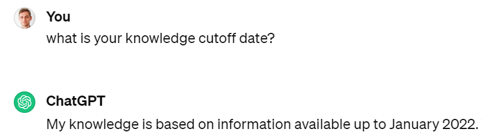
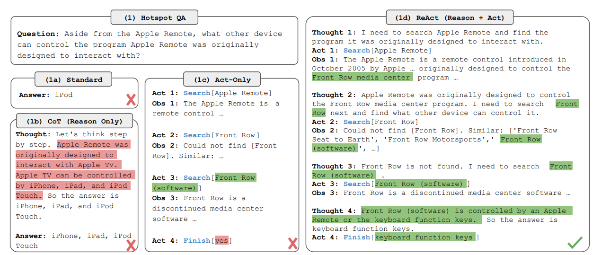
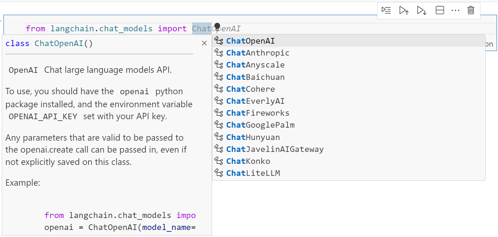
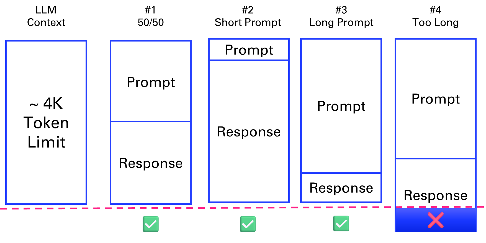
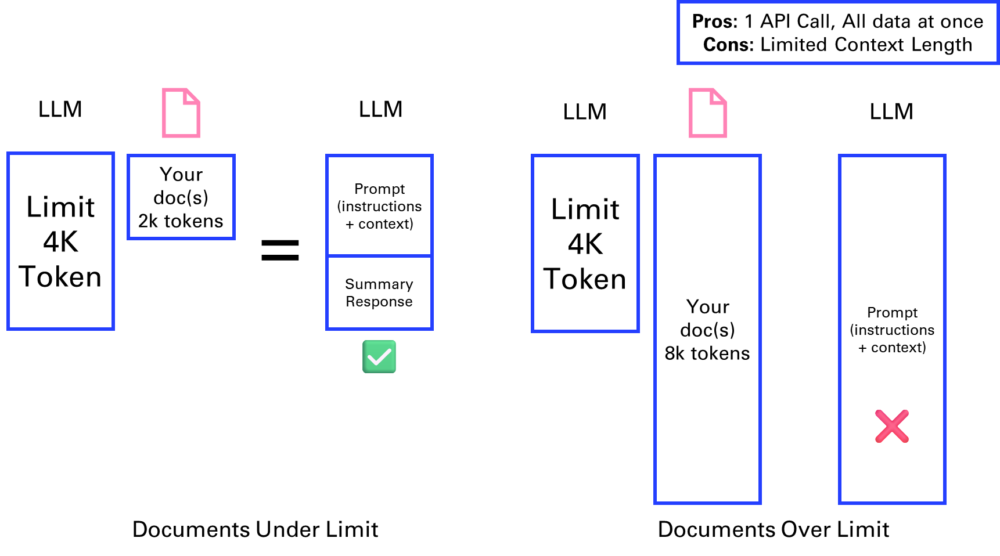
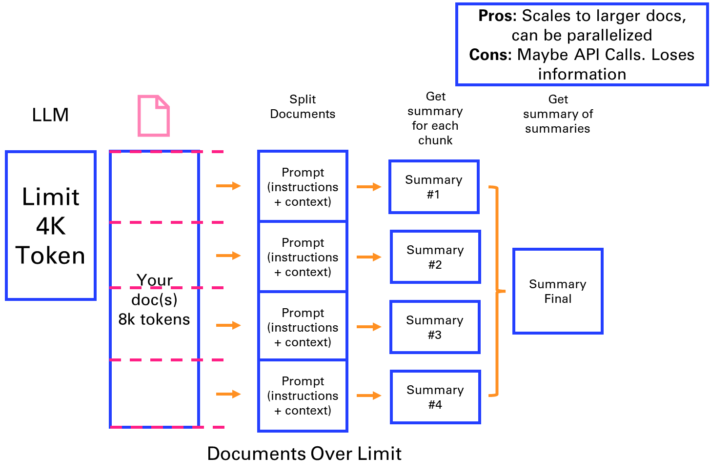
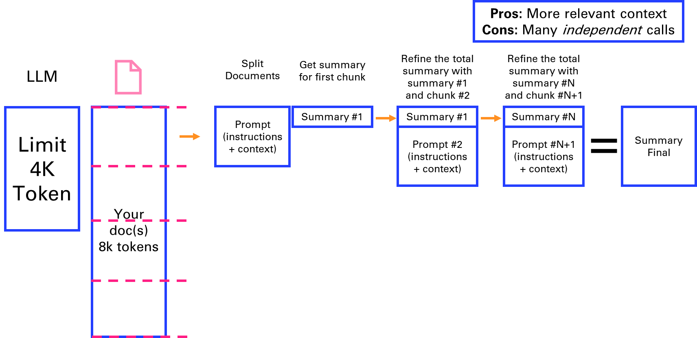

# 3. Prompting, Chaining and Summarization

Now that you have seen the basics of how to develop a chatbot application, let’s discover how to go from a generic AI agent into more specific use cases. In this chapter, you will learn how to craft efficient prompts, to leverage advanced chaining methods, and to apply those methods to a concrete summarization application on texts, such as articles, books, or transcripts.

## 3.1. The art of prompting

This chapter is meant to give you an intuitive understanding of how to interact with GPT models by careful writing prompts, in such a way that the model can understand. This simplistic explanation is what is currently known as the art and science of *prompt engineering*.

Or as Monsieur Jourdain, the main character of Molière's *The Bourgeois Gentleman*, would describe it: speaking in prose without knowing it. Shortly after the release of ChatGPT, you may have seen a lot of buzz in articles online, as well as the new profession of “prompt engineer” that supposedly is the future of many jobs such as programmer. I won’t engage much further on this debate, but I will instead attempt to list down the recipes that make a good prompt.

Here is a simple example of what could be described as a bad prompt, inherited from the age of googling and simple keyword search, with one quick fix that precise a little more the intent behind the request:

- *Ineffective Prompt***:** "Quantum mechanics."

- *Effective Prompt***:** "In simple terms, explain the basic principles of quantum mechanics to a high school student."

Creating an effective prompt involves clarity, context, and specificity.

- *Clarity*: Be explicit about the task.

- *Context***:** Provide necessary background information.

- *Specificity***:** Define the format and style of the desired response.

There are some additional techniques for improving responses:

- *Role Assignment***:** Assign a role to guide perspective.

``` python
prompt = "You are a movie critic. Analyze the Star Wars saga."
```

- *Formatting Instructions***:** Guide the structure of the output (you can specify the desired length of the response).

``` python
prompt = "List the top 3 best Star Wars movies in bullet points."
```

- *Style Guidelines***:** Specify tone and style.

``` python
prompt = "Write a friendly email from Chewbacca to Han Solo."
```

An important part of effective prompting is providing the necessary context. There are different approaches to this that will be covered throughout the book. The simplest method that was introduced in the GPT-3 paper is few-shot prompting. Essentially, the idea is to provide examples of inputs and outputs from which the language model can generalize the pattern. This is an illustration for a translation task:

``` python
prompt = """Translate the following sentences from English to French.\n\n
1. 'Hello, how are you?'
-> 'Bonjour, comment ça va?'
2. 'Good morning.'
->
"""
```

Different variations of this method will be leveraged, and more generally you will see a mix of each of the techniques above used in some of the code snippets of the book that perform calls to GPT models.

## 3.2. Prompt engineering techniques in app development

You should not only think about GPTs as chatbots. Here is an example that illustrate an application requiring the use of several AI agents to manage and curate a database of bookmarks. The pitch is the following: As a tech professional, I often accumulate a vast collection of bookmarks for articles, tutorials, documentation, and blog posts. Managing this extensive library presents several challenges:

- *Insights*: Identifying trends or areas of focus within the collection.

- *Organization*: Keeping bookmarks categorized and easy to navigate.

- *Summarization*: Obtaining concise overviews without re-reading entire articles.

- *Retrieval*: Quickly finding relevant articles when needed (it will be covered in the next chapter).

Throughout this chapter, we will develop an app that:

1.  *Extracts* key information from each bookmarked article (title, author, content).

2.  *Translate* all articles in a target language (here mostly from French to English).

3.  *Classifies* articles into relevant tech categories (e.g., Machine Learning, Web Development).

4.  *Summarize* concise abstracts for quick reference, after identifying some key points.

5.  *Scales* to thousands of bookmarks efficiently with prompt templates.

### Extract content

Assuming you have gathered content over the years as bookmarks in your web browser or in your favorite bookmarking service (for me it was Diigo), the first step will be to export those into a structured format. For each bookmark, you will typically have:

- URL

- Title

- Date added

The first step is to fetch the content from each URL and extract the main text using web scraping tools.

``` python
import requests
from bs4 import BeautifulSoup
def extract_content(url):
    try:
        # Fetch the URL content
        response = requests.get(url)
        response.raise_for_status()  # Raise an error for bad status codes
        html = response.text
       
        # Parse the HTML using BeautifulSoup
        soup = BeautifulSoup(html, 'html.parser')
        title = soup.title.string if soup.title else "No Title Found"
        content = soup.get_text(separator='\n')
       
        return title, content
    except Exception as e:
        print(f"Error fetching {url}: {e}")
        return None, None
```

Based on this extracted content, you can format it properly and store it in a text file. Here is a function that uses OpenAI to format the content:

``` python
def format_content(title, content):
    try:
        prompt = f"""You are an expert text formatter and summarizer.
        Here is an article:
       
        Title: {title}
       
        Content:
        {content}
       
        Please format this scraped text into a clean, readable content."""
        formatted_content = bot(prompt)
        return formatted_content
    except Exception as e:
        print(f"Error formatting content with OpenAI: {e}")
        return "Failed to format content."
```

For any of the operations requiring AI in this chapter, let’s implement a generic function using the OpenAI API:

``` python
import openai
def bot(prompt, max_tokens=150, temperature=0):
    response = openai.chat.completions.create(
        model='gpt-4o-mini',
        messages=[
            {"role": "user", "content": prompt}
        ],
        max_tokens=max_tokens,
        temperature=temperature
    )
    return response.choices[0].message.content.strip()
```

**<u>/!\\</u>** The temperature is set to 0 by default as most of the operations you will be performing in this example do not require much creativity.

### Translate articles: Zero-shot Prompting

An important step to standardize all the content for the knowledge base is to translate all the articles in English. Luckily for us, translation is one of the natural language processing tasks in which language models excel, especially as they are getting quite large and capable in multiple languages.

Here is a short function that uses a simple prompt, without the need to give any illustrative example:

``` python
def translate_article(content):
    prompt = f"""
    Translate the following article in English:
    \"\"\"
    {content}
    \"\"\"
    Translation:
    """
    translation = bot(prompt)
    return translation.strip()
```

**<u>/!\\</u>** You actually do not need to translate different languages to English in order to perform further processing like classification from different languages. The GPT models are able to reason around different language inputs. But this is much more convenient to start with this if there is a need to involve a human in the loop to verify the results of each step of the pipeline.

### Classify articles: Few-Shot Prompting

Classification is a perfect illustration of few-shots prompting. This concept introduced in chapter 1 with the GPT-3 paper demonstrates how giving one or several examples of the expected result can greatly increase the performance of the prediction.

In this case, you can provide examples to help the model classify articles into predefined categories.

``` python
def classify_article(content):
    prompt = """
    You are an AI assistant that classifies technical articles into categories. The categories are:
    - Machine Learning
    - Web Development
    - Mobile Development
    - Cloud Computing
    - Data Science
    - Programming Languages
    - Other
    For example:
    Article:
    \"\"\"
    An introduction to Kubernetes and container orchestration.
    \"\"\"
    Category: Cloud Computing
    Article:
    \"\"\"
    Understanding React Hooks and their usage in modern web apps.
    \"\"\"
    Category: Web Development
    Now classify this article:
    \"\"\"
    {}
    \"\"\"
    Category:""".format(content)
    category = bot(prompt)
    return category.strip()
```

**<u>/!\\</u>** One way to make the result of this function easier to process would be to leverage the JSON mode[^1].

### Summarize abstracts: Chain-of-Thought Prompting 

As we compare GPT models to the human brain, one concept that enables us to draw this parallel is *Chain-of-Thoughts*[^2]. It is typically express with a prompt that contains an expression such as:

*“Think step by step before you answer”*

This way the model is using additional tokens in his answer to “spell out” some of its thinking and can reflect on it in a later stage. In our case, you can encourage the model to think step by step to extract relevant keywords from the article.

``` python
def summarize_article(content):
    key_points_prompt = f"""
    You are an AI assistant that summarizes technical articles. Read the article below and think through the main points step by step before writing the final summary.
    Article:
    \"\"\"
    {content}
    \"\"\"
    First, outline the key points and main ideas of the article. Then, write a concise summary incorporating these points.
    Key Points:
    """
    # First, get the key points
    key_points_response = bot(key_points_prompt)
    key_points = key_points_response.strip()
    # Now, generate the final summary using the key points
    summary_prompt = f"""
    Using the key points below, write a concise summary of the article.
    Key Points:
    {key_points}
    Summary:
    """
    summary = bot(summary_prompt)
return summary.strip()
```

Summarization is one of the most useful applications of language models. And you can get very varying results based on how you approach this task. You can consider using the o1 family of models for this type of task as they excel at reasoning, and stuff everything into one single prompt. But on the other hand of the spectrum, it doesn’t necessarily take a very advanced or large model to only perform summarization, and you can consider farming this out to dedicated services with small language models.

Whenever you involve humans in a language processing task, summarization is a key ingredient, so make sure that you validate the results to make sure that the quality of the summary aligns with the level of information that you want to present to your users.

**<u>/!\\</u>** You might hit up against the context length. You will learn in the following sections of this chapter how to work around this.

### Scale processing: Prompt templates

You can process bookmarks in batches to handle large volumes efficiently. Remember that in such cases you can use the batch API from ChatGPT to pay 50% less, if you don’t need the result right away. You can also consider parallelizing this processing loop, as each call can be performed independently.

``` python
def process_bookmarks(bookmarks):
    processed_articles = []
    for bookmark in bookmarks:
        url = bookmark['url']
        title, content = extract_content(url)
        content = format_content(title, content)
        summary = summarize_article(content)
        category = classify_article(content)
        article_data = {
            'title': title or bookmark['title'],
            'category': category,
            'summary': summary,
        }
        processed_articles.append(article_data)
        # Optionally save to a database or file
    return processed_articles
```

**<u>/!\\</u>** In every function introduced in this section, we have been using Python formatted strings[^3]. This method of including numbers into textual outputs is extremely relevant when it comes to templating calls to GPT models.

## 3.3. Why chaining

Chaining is a technique that allows you to send multiple requests to an LLM in a sequence, using the output of one request as the input of another. This way, you can leverage the power of an LLM to perform complex tasks that require multiple steps, such as summarization, text simplification, or question answering.

The benefits of chaining are the following:

- *Enhanced contextual understanding*: By chaining calls, the LLM can maintain context over a longer interaction, leading to more coherent and relevant responses.

- *Complex task handling*: Chaining allows for the breakdown of complex tasks into simpler sub-tasks, which the model can handle more effectively.

Chaining enables to “fix” some of the inherent limitations of LLMs:

- *Reasoning*: LLMs are not proceeding like the human brain – remember, they simply infer the next logical word in a sentence. As such they are not good at solving basic math problems.

- *Access to Data and Tools*: LLMs do not have access to your data, only the ones they have seen during the training phase. By default, they do not have access to search over the internet. As such, it would not make sense to compare ChatGPT with Google search, even if their use cases overlap significantly.

- *Training set fixed in time*: You probably remember ChatGPT saying that he did not have access to information after September 2021. This date is gradually updated by OpenAI but there is always a lag.



*Figure 3‑1 A typical response from ChatGPT mentioning is knowledge limitations*

A major paper that has been at the origin of many of the improvements of the usage of LLMs is *React: Synergizing Reasoning and Acting in Language Models*[^4].



*Figure 3‑2 Example from the ReAct paper combining Reasoning and Acting*

Instead of directly answering a question, this approach breaks down the process into Reasoning + Acting. A number of frameworks emerged to provide developers with the ability to integrate LLMs into their applications, by implementing the ReAct concepts. I’ll cover the few main ones in this book:

- Semantic Kernel

- LangChain

- LlamaIndex

- Haystack

Most of those frameworks that appeared in 2023 came to complement LLMs like ChatGPT or open-source alternatives such as Llama2. But it is good to note that with new features enabled by OpenAI throughout the year, the need for those frameworks became less and less relevant as OpenAI has increasingly been providing an end-to-end integrated solution.

We will break down the analysis of those frameworks over the course of the next 3 chapters:

- First, we will look at the basics of chaining to go around the limitations of the LLM context

- Second, we will look at methods such as vector search to extend the LLM context

- Third, we will look at properties that appear when we extend the reasoning of LLMs

### Semantic Kernel by Microsoft

I’m choosing to start with Semantic Kernel, as Microsoft provides good educational material on the main concepts around chaining. Semantic Kernel[^5] is a lightweight Software Development Kit (SDK) developed by Microsoft that enables to mix conventional programming languages and Large Language Models with templating, chaining, and planning capabilities. Here is a diagram that explains the workflow triggered by the user asking a question:


*Figure 3‑3 Journey of a request from an ASK to the Semantic Kernel framework\
all the way to the response the user GETs*

| *Journey* | *Short Description* |
|:--:|----|
| ASK | A user's goal is sent to SK as an ASK |
| Kernel | The kernel orchestrates a user's ASK |
| Planner | The planner breaks it down into steps based upon resources that are available |
| Resources | Planning involves leveraging available skills, memories, and connectors |
| Steps | A plan is a series of steps for the kernel to execute |
| Pipeline | Executing the steps results in fulfilling the user's ASK |
| GET | And the user gets what they asked for ... |

*Table 3‑1 Semantic Kernel workflow*

### LangChain **🦜🔗**

LangChain is a framework that enables developers to chain calls to Large Language Models (such as ChatGPT). It offers implementations both in Python and Typescript (in order to migrate easily your experimentations into a JavaScript web app). We won’t be needing this as we will reuse Streamlit.

Many of the concepts introduced in the early days of the LangChain framework were meant to complements the Large Language Models such as GPT 3.5:

- Extend the length of the context

- Augment generation by retrieving elements not in the context

- Add tools such as loading documents, searching the internet or doing basic math

Before ChatGPT was introduced (with the underlying 3.5 turbo model), you could already abstract the call to OpenAI GPT 3 models with LangChain, with a very simple syntax:

``` python
from langchain.llms import OpenAI
llm = OpenAI()
joke = llm('tell me a joke')
print(joke)
```

```
Q: What did the fish say when he hit the wall?
```

A: Dam!

It also provided the ease of swapping models providers:



*Figure 3‑4 Autocomplete in VSCode displaying the chat models available in LangChain*

But the use of chat models (like gpt-3.5-turbo) were preferred to base models performing simple text completion. They’ve been significantly optimized, and they are now the standard models available, so it is best to standardize your code on chat models.

``` python
from langchain.chat_models import ChatOpenAI
from langchain.schema import HumanMessage
chat = ChatOpenAI()
text = "Tell me a joke"
messages = [HumanMessage(content=text)]
res = chat.invoke(messages)
print(res.content)
```

```
Sure, here's a classic joke for you:
Why don't scientists trust atoms?
Because they make up everything!
```

To learn more about LangChain, I would recommend the Youtube channel of Greg Kamradt[^6].

## 3.4. Summarizing long documents

Summarization is one of the main use cases of Natural Language Processing that is used productively in a professional setting. The first application that came to my mind to leverage ChatGPT was summarizing meetings. This way I could simply turn on the transcription on Microsoft Teams and skip long overcrowded meetings. The same could be applied to long documents that I don’t want to read.

### Working around the context length

Now there is one problem with this: a typical one-hour meeting is around 8k to 10k tokens. But initially the GPT-3.5 model powering ChatGPT could only handle 4096 tokens.



*Figure 3‑5 scenarios where the prompt and response fit the context length and 1 where it doesn’t*

What are *tokens* anyway? A helpful rule of thumb is that one token generally corresponds to ~4 characters of text for common English text. This translates to roughly ¾ of a word (so 100 tokens ~= 75 words). In what follows, we will use the tiktoken package from OpenAI anytime we need to compute precisely the number of tokens within our applications.

What does this mean in terms of pages? One page in average is 500 words[^7] (like the first page of the forewords in Letter format 8.5” x 11”). Which means that 4k tokens can fit 6 pages of text. As the previous diagram suggests, this context length is shared between the prompt and the response.

Let’s illustrate this with a basic example of a conversation recorded as WebVTT file[^8]:

``` python
import os, webvtt
files = os.listdir('../data/vtt')
file = files[1]
cap = webvtt.read('../data/vtt/'+file)
for caption in cap[1:5]:
    # print(f'From {caption.start} to {caption.end}')
    # print(caption.raw_text)
    print(caption.text)
```

```
I want to start doing this experiment where.
We have a conversation we record it's generating a VTT file.
And I have a parser. I developed a small app in Python that can retrieve the VTT file process it.
And then.
```

We can extract the text from the conversation and save it as a plain text file.

``` python
txt = file.replace('.vtt','.txt')
m = [caption.raw_text for caption in cap]
sep = '\n'
convo = sep.join(m)
with open('../data/txt/'+txt,mode='w') as f:
    f.write(convo)
```

Let's count the numbers of token in the conversation.

``` python
import tiktoken
def num_tokens(string: str) -> int:
    """Returns the number of tokens in a text string."""
    encoding_name = 'cl100k_base'
    encoding = tiktoken.get_encoding(encoding_name)
    num_tokens = len(encoding.encode(string))
    return num_tokens
num_tokens(convo)
```

150

In the next parts, we will go over different chain types to address the limitation of the context length[^9].

### Stuffing

The first solution presented is "stuffing". If a document is within the model’s context limit (4k tokens here), it can be directly fed into the API for summarization. This method is straightforward but limited by the maximum context length.



Figure 3‑6 Stuffing a document into the context

This is how the code would look like with LangChain:

``` python
from langchain.chains.summarize import load_summarize_chain
from langchain.chat_models import ChatOpenAI
from langchain.document_loaders import WebBaseLoader, TextLoader
loader = TextLoader('../data/txt/'+txt)
docs = loader.load()
llm = ChatOpenAI(temperature=0, model_name="gpt-3.5-turbo")
chain = load_summarize_chain(llm, chain_type="stuff")
chain.run(docs)
```

```
'Yann wants to improve his French accent and plans to conduct an experiment where he records conversations and generates VTT files. He has developed a Python app to process the VTT files and wants to use the ChatGPT API to further analyze them. Mike has not yet used the API due to lack of time.'
```

Try summarizing a longer text, like the content of a webpage like the LangChain doc page.

``` python
def summarize(page, model = "gpt-3.5-turbo"):  
    loader = WebBaseLoader(page)
    docs = loader.load()
    llm = ChatOpenAI(temperature=0, model_name=model)
    chain = load_summarize_chain(llm, chain_type="stuff")
    return chain.run(docs)
page = "https://python.langchain.com/docs/use_cases/summarization"
try:
    summary = summarize(page)
    print(summary)
except Exception as e:
    print(str(e))
```

```
Error code: 400 - {'error': {'message': "This model's maximum context length is 4097 tokens. However, your messages resulted in 7705 tokens. Please reduce the length of the messages.", 'type': 'invalid_request_error', 'param': 'messages', 'code': 'context_length_exceeded'}}
```

Luckily as we will see in the last part of this chapter we can use a model with a larger context window:

``` python
page = "https://python.langchain.com/docs/use_cases/summarization"
summarize(page,model = "gpt-3.5-turbo-16k")
```

```
'The LangChain platform offers tools for document summarization using large language models (LLMs). There are three approaches to document summarization: "stuff," "map-reduce," and "refine." The "stuff" approach involves inserting all documents into a single prompt, while the "map-reduce" approach summarizes each document individually and then combines the summaries into a final summary. The "refine" approach iteratively updates the summary by passing each document and the current summary through an LLM chain. The platform provides pre-built chains for each approach, and users can customize prompts and LLM models. Additionally, the platform offers the option to split long documents into chunks and summarize them in a single chain.'
```

### Map reduce

The MapReduce method involves splitting a large document (e.g., 8k tokens) into smaller chunks, summarizing each separately, and then combining these summaries into a final summary. This approach allows for processing larger documents in parallel API calls but may lose some information.

This is a term that some might be familiar with, from the space of big data analysis, where it represents a distributed execution framework that parallelized algorithms over data that might not fit on a single core.



*Figure 3‑7 Map reduce approach to breaking down a summary into parallel steps*

As an example, we will take another source of VTT files: Youtube transcripts[^10]. The video we will summarize is the LangChain Cookbook - Beginner Guide To 7 Essential Concepts[^11].

``` python
from youtube_transcript_api.formatters import WebVTTFormatter
from youtube_transcript_api import YouTubeTranscriptApi
video_id = "2xxziIWmaSA" # https://www.youtube.com/watch?v=2xxziIWmaSA
transcript = YouTubeTranscriptApi.get_transcript(video_id)
formatter = WebVTTFormatter()
formatted_captions = formatter.format_transcript(transcript)
vtt_file = f'../data/vtt/subtitles-{video_id}.vtt'
with open(vtt_file, 'w') as f:
    f.write(formatted_captions)
sep = '\n'
caption = sep.join([s['text'] for s in transcript])
num_tokens(caption)
```

```
10336
```

``` python

txt_file = vtt_file.replace('vtt','txt')
with open(txt_file,mode='w') as f:
    f.write(caption)
```

Now comes a new concept that will be important anytime you are breaking down content into chunks: a *text splitter*[^12].

The default recommended text splitter is the RecursiveCharacterTextSplitter. This text splitter takes a list of characters. It tries to create chunks based on splitting on the first character, but if any chunks are too large it then moves onto the next character, and so forth. By default, the characters it tries to split on are \["\n\n", "\n", " ", ""\]

In addition to controlling which characters you can split on, you can also control a few other things:

- length_function: how the length of chunks is calculated. Defaults to just counting number of characters, but it's pretty common to pass a token counter here.

- chunk_size: the maximum size of your chunks (as measured by the length function).

- chunk_overlap: the maximum overlap between chunks. It can be nice to have some overlap to maintain some continuity between chunks (e.g. do a sliding window).

- add_start_index: whether to include the starting position of each chunk within the original document in the metadata.

``` python
text_splitter = RecursiveCharacterTextSplitter(
    chunk_size = 1000,
    chunk_overlap = 0,
    length_function = num_tokens,
)
def doc_summary(docs):
    print (f'You have {len(docs)} document(s)')
    num_words = sum([len(doc.page_content.split(' ')) for doc in docs])
    print (f'You have roughly {num_words} words in your docs')
    print ()
    print (f'Preview: \n{docs[0].page_content.split(". ")[0][0:42]}')
docs = text_splitter.split_documents(doc)
doc_summary(docs)
```

```
You have 11 document(s)
You have roughly 7453 words in your docs
Preview:
hello good people have you ever wondered
```

We can now perform the MapReduce method. We can enable the mode verbose=True to view the breakdown of each intermediate summary.

``` python
llm = ChatOpenAI(model_name='gpt-3.5-turbo')
chain = load_summarize_chain(llm, chain_type="map_reduce", verbose=True)
chain.run(docs)
```

```
"The video introduces Lang chain, a framework for developing applications powered by language models. It explains the components and benefits of Lang chain, and mentions a companion cookbook for further examples. The video discusses different types of models and how they interact with text, including language models, chat models, and text embedding models. It explains the use of prompts, prompt templates, and example selectors. The process of importing and using a semantic similarity example selector is described. The video also discusses the use of text splitters, document loaders, and retrievers. The concept of vector stores and various platforms are mentioned. The video explains how chat history can improve language models and introduces the concept of chains. It demonstrates the creation of different chain types in Lang chain, such as location, meal, and summarization chains. The concept of agents and their application in decision making is discussed, along with the process of creating an agent and loading tools into its toolkit. The speaker shares their positive experience using Lion Chain software and its ability to dynamically search for information. They mention the debut album of Wild Belle and encourage viewers to check out the band's music. The video concludes by mentioning future videos on the topic and encouraging viewers to subscribe and provide feedback."
```

### Refine

In the Refine method, the document is split into chunks, and each chunk is summarized sequentially, with each summary informed by the previous one. This method provides relevant context but is time-consuming due to its sequential nature. This is one of my favorite methods for summarizing.



*Figure 3‑8 Refining a summary in sequential steps*

We can directly try this method on the same content as the previous section and see how it compares.

``` python
chain = load_summarize_chain(llm, chain_type="refine", verbose=True)
chain.run(docs)
```

You can observe in the verbose output that the chain uses the following prompt:

```
Given the new context, refine the original summary.
If the context isn't useful, return the original summary.
```

Finally, I'll implement my own text splitter and summarizer using the refine method.

``` python
def my_text_splitter(text,chunk_size=3000):
    # Split text into chunks based on space or newline
    chunks = text.split()
    # Initialize variables
    result = []
    current_chunk = ""
    # Concatenate chunks until the total length is less than 4096 tokens
    for chunk in chunks:
        # if len(current_chunk) + len(chunk) < 4096:
        if num_tokens(current_chunk+chunk) < chunk_size:
            current_chunk += " " + chunk if current_chunk else chunk
        else:
            result.append(current_chunk.strip())
            current_chunk = chunk
    if current_chunk:
        result.append(current_chunk.strip())
    return result
import openai
def summarize(text, context = 'summarize the following text:', model = 'gpt-3.5-turbo'):
    completion = openai.chat.completions.create(
        model = model,
        messages=[
        {'role': 'system','content': context},
        {'role': 'user', 'content': text}
            ]
    )
    return completion.choices[0].message.content
def refine(summary, chunk,  model = 'gpt-3.5-turbo'):
    """Refine the summary with each new chunk of text"""
    context = "Refine the summary with the following context: " + summary
    summary = summarize(chunk, context, model)
    return summary

chunks = my_text_splitter(caption)
summary = summarize(chunks[0])
for chunk in chunks[1:]:
    summary = refine(summary, chunk)
summary
```

```
'In this video, the presenter discusses the Lang chain framework and its various components, including Vector Stores, Memory, Chains, and Agents. They provide code examples and highlight the versatility and functionality of using Lang chain. In the end, they encourage viewers to subscribe for part two and ask any questions they may have. They also share tools on Twitter and encourage feedback and comments from viewers.'
```

### Evolutions of the context window

This early view of limitations of Large Language Models has to be updated over time as the context length of new generations of LLMs are growing:

- GPT 4[^13] (introduced on March 14, 2023) originally had an 8k tokens context window. A 32k tokens version was made available gradually in parallel. In November 2023, an 128k token version was introduced.

- GPT 3.5 got a 16k version in September 2023.

- Anthropic Claude[^14] extended its context window to 100k tokens in May 2023, enabling to process an entire book like the Great Gatsby of around 200 pages (standard paperback edition).

- Claude 2.1[^15] (Nov 2023) and Claude 3 (Mar 2024) propose an impressive 200k tokens context.

- LLaMa[^16] from Meta initially came with a 2k tokens context window in February 2023.

- Llama2[^17] released in July 2023 has a 4k tokens context window. Llama3 released in April 2024 doubles it again to 8k tokens. This is considered one of the leading open-source LLM.

- GPT 4o[^18] (introduced on May 13, 2024) has a 128k tokens context window.

There are still advantages to apply the previous methods, either to mitigate the cost of long context windows and larger models, or to use smaller more dedicated models that can be open-source for certain specific tasks like summarizing.

[^1]: Structure outputs in JSON: <https://platform.openai.com/docs/guides/structured-outputs#json-mode>

[^2]:  Chain-of-Thought:<https://blog.research.google/2022/05/language-models-perform-reasoning-via.html>

[^3]:  Python formatted strings: <https://docs.python.org/3/tutorial/inputoutput.html>

[^4]:  ReAct paper: <https://arxiv.org/abs/2210.03629>

[^5]:  Semantic Kernel: <https://learn.microsoft.com/fr-fr/semantic-kernel/>

[^6]:  Langchain tutorials:\
    <https://youtube.com/playlist?list=PLqZXAkvF1bPNQER9mLmDbntNfSpzdDIU5>\
    <https://github.com/gkamradt/langchain-tutorials>

[^7]:  Words per page: <https://wordcounter.net/words-per-page>

[^8]:  WebVTT file: <https://developer.mozilla.org/en-US/docs/Web/API/WebVTT_API>

[^9]:  Workaround Token Limits With Chain Types: <https://www.youtube.com/watch?v=f9_BWhCI4Zo>

[^10]:  <https://pypi.org/project/youtube-transcript-api/>

[^11]:  <https://www.youtube.com/watch?v=2xxziIWmaSA>

[^12]:  <https://python.langchain.com/docs/modules/data_connection/document_transformers/#text-splitters>

[^13]:  GPT 4 model: [https://platform.openai.com/docs/models/gpt-4](https://platform.openai.com/docs/models/gpt-4-and-gpt-4-turbo)

[^14]:  Anthropic Claude 100k context window: <https://www.anthropic.com/index/100k-context-windows>

[^15]:  Claude 2 & 3: <https://www.anthropic.com/news/claude-2-1> - <https://www.anthropic.com/news/claude-3-family>

[^16]:  LLaMa: <https://ai.meta.com/blog/large-language-model-llama-meta-ai/>

[^17]:  Llama 2 & 3: <https://llama.meta.com/llama2/> - <https://llama.meta.com/llama3/>

[^18]:  <https://openai.com/index/hello-gpt-4o/>

---

[⬅️ OpenAI APIs](2_OpenAI_APIs.md) | [🏠 Home](README.md) | [Vector search & Question Answering ➡️](4_Vector_search_Question_Answering.md)
