# 9. Deploying GPTs

In this final chapter, we are taking the last step in the journey with GPTs. We will deploy your AI agents, either on the OpenAI GPT Store, or on your preferred hosting service (in my case Streamlit). Those two deployment options are not mutually exclusive, but as you can see on Figure 9-1, they adopt a different architecture, between the front-end, the AI agent, and the tools at its disposal:

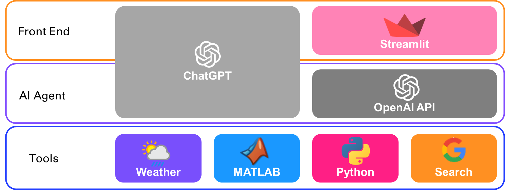

*Figure 9‑1 GPTs deployment architecture options*

**<u>/!\\</u>** Note that the tools can either be deployed as independent microservices, or as Python functions within the Streamlit app in the second option.

## 9.1. Deploy on the OpenAI GPT Store

In this section, we will see how you can use the GPT builder in the ChatGPT App, and how you can deploy your custom GPTs built in the OpenAI platform on the GPT Store.

Start by asking yourself what is the personal or professional tasks for which you want to design your own AI agent. If the task requires certain tools, you will see how to equip your agent with those tools as web services that the GPT will call.

- Create a custom GPT with the GPT builder

Log in to your ChatGPT account to create your custom GPTs using a low code builder:

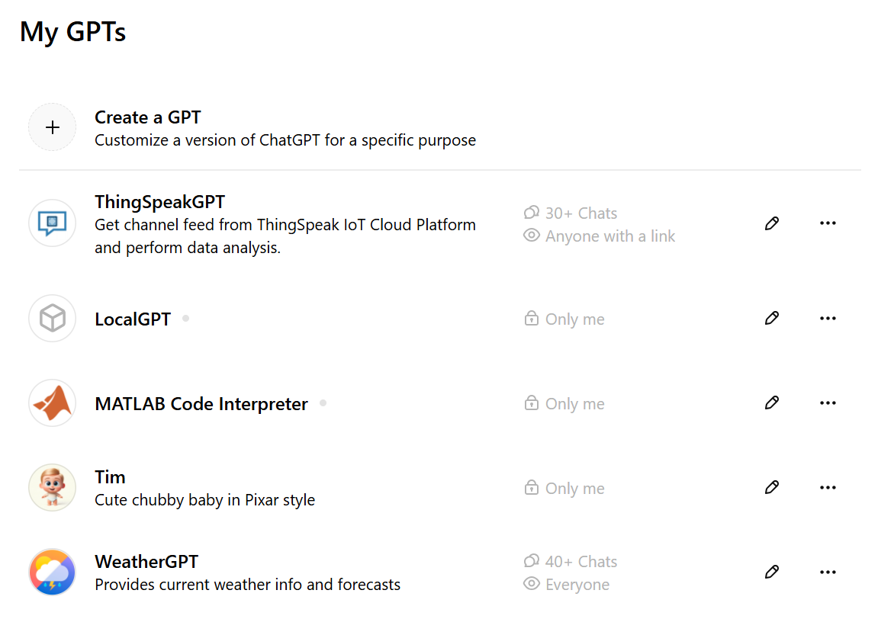

Figure 9‑2 List of my Custom GPTs

WeatherGPT is in the GPT Store: <https://chatgpt.com/g/g-HB1PWjLVs-weathergpt>

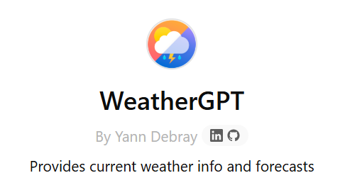

*Figure 9‑3 My WeatherGPT*

Here is an example of what it does:

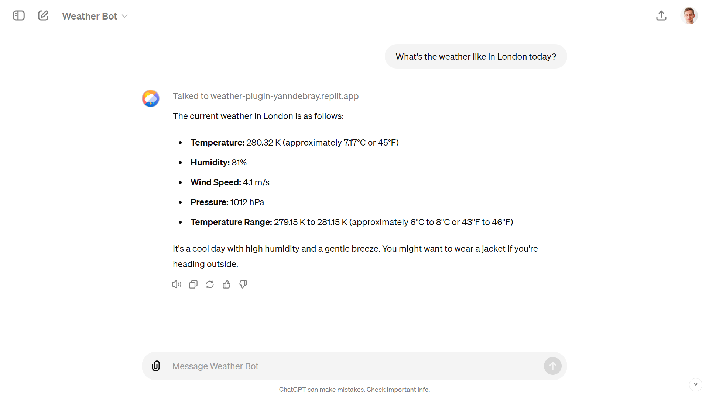

*Figure 9‑4 Conversation inside ChatGPT with my WeatherGPT*

You can create your own GPT with the low-code GPT builder in the ChatGPT app:

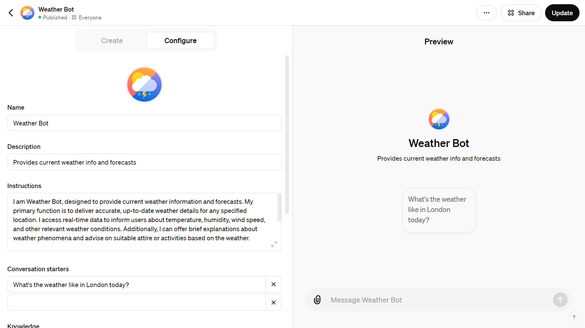

*Figure 9‑5 Create a new custom GPT without coding*

However, what you can achieve through a custom GPT without coding is fairly limited compared to what you have learned in this book.

- Extend the capabilities of your custom GPT access to web services

The secret ingredient in my Weather GPT is the ability to call a weather service. For this I’m using an *Action*. To find out more about actions[^1], you can ask help to ActionsGPT.

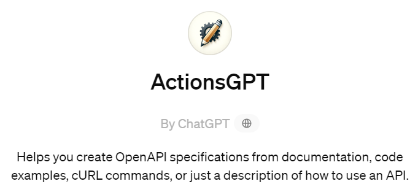

*Figure 9‑6 ActionsGPT*

Actions are specified in the OpenAPI format (don’t confuse with OpenAI without a P):

Schema openapi.yml

``` python
openapi: 3.1.0
info:
    title: Weather
    description: Get weather data for a given city.
    version: "v1"
servers:
    - url: https://weather-plugin-yanndebray.replit.app/
paths:
    /weather:
        get:
            operationId: getWeatherData
            summary: Retrieves the weather data.
            parameters:
                - in: query
                  name: city
                  schema:
                      type: string
                  description: For example, London,uk.
            responses:
                "200":
                    description: OK
```

I have implemented a very simple tool based on this specification that gets the weather with the Flask web framework[^2]. You can simply ask ChatGPT to generate the Flask server for you based on the schema above. For this demonstrator, I’ve deployed my get_weather_data function with Replit[^3]:

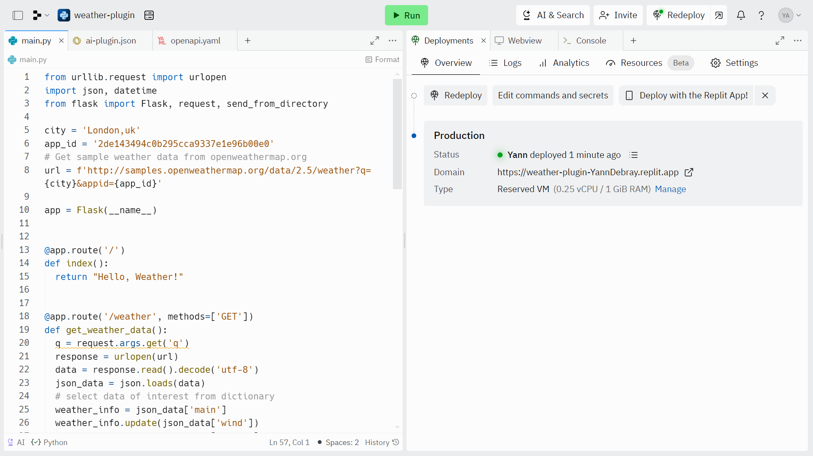

*Figure 9‑7 Deploy action in Replit*

Another hosting service to deploy multiple tools as web services is Render[^4]. Render has a generous free tier that enables you to deploy multiple web services, as long as their combined runtime is capped at 750 instance hours per month. Free web services automatically spin down after 15 minutes of inactivity and spin back up upon receiving a new request. This behavior can introduce delays due to cold starts when the service is accessed after being idle. I still recommend this service to deploy your GPT tools because it is almost as easy to use as Replit, and the free tier lets you ramp up on GPTs before you feel compelled to upgrade your service to a higher availability (hopefully because you have plenty of users hitting your GPT in the OpenAI store).

Finally, this is how it looks like to call a weather tool from my WeatherGPT, in debug mode to test the endpoint:

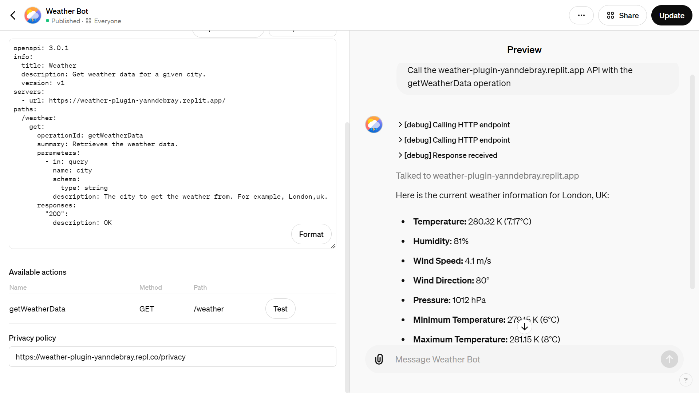

*Figure 9‑8 Call weather endpoint from your custom GPT*

## 9.2. Deploy GPT Apps on Streamlit Cloud

In each chapter, you have seen one of the extended capabilities of the OpenAI API. Let’s summarize all of those into one multipage app. This should act as a companion to this book, and a template for you to start your own AI-powered product (you just have to bring your own OpenAI API key). I’ll personify each of the GPTs that we will go through in this app and give each of them a funny name, as shown in Figure 9-10.

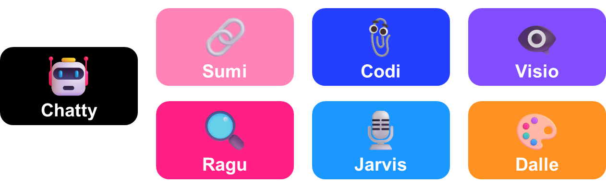

*Figure 9‑9 Each GPT is illustrating one of the chapter in the book*

- 🤖chatty:

Our good old chat, with the memory of the conversation saved as session state. This one is important to get the basics of how to call an LLM. In the appendix, we will see a version of chatty calling Mistral AI.

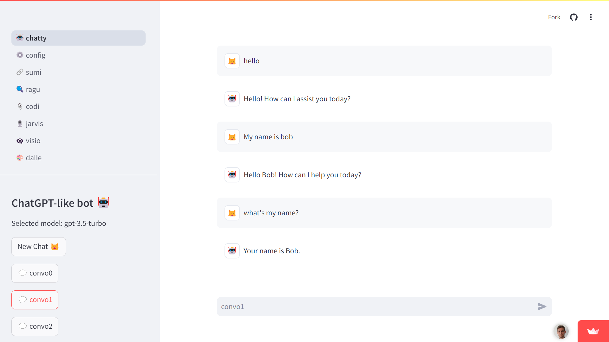

*Figure 9‑10 Chatty the OG*

- ⚙️ config:

This isn’t really a GPT, but more an extension of chatty. It enables you to configure your bot, export and delete the history of messages. This way if you want to host this app online, you can give basic privacy settings to your users.

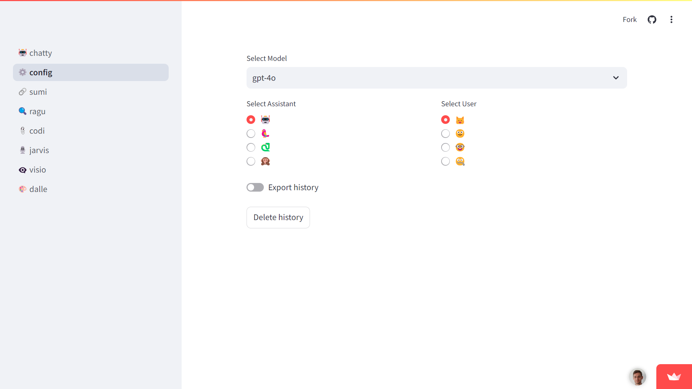

*Figure 9‑11 Config for any GPT*

- 🔗 sumi:

Summarizing is a useful use case of LLMs, and it is one of the first GPTs I created when the GPT-3.5 API came out. This version is more meant for pedagogical objective to explain how the text is broken down into chunks, and to see the impact of changing the chunk size, for instance from 1000 to 900 on chapter 8 that represents 1967 tokens in total. You can also try it out on longer chapters, to observe how the summary gets refined over the iterations.

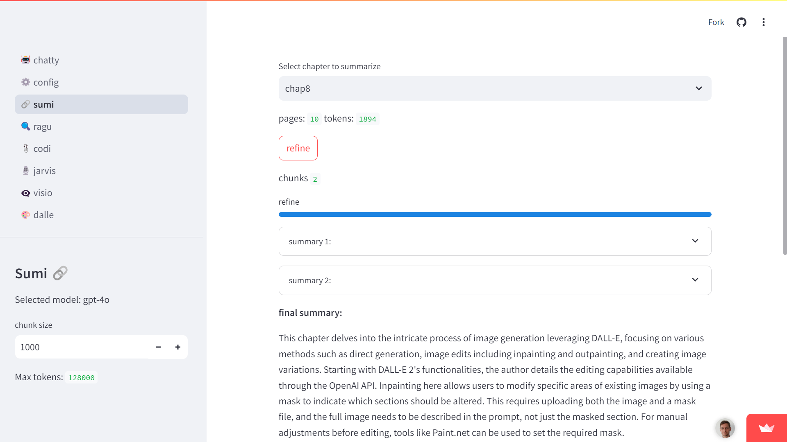

*Figure 9‑12 Sum of all the things you've learned*

- 🔍 ragu:

This GPT uses a vector database that contains the chapters of this book to answer questions. You can derive your own version with the database of your choice.

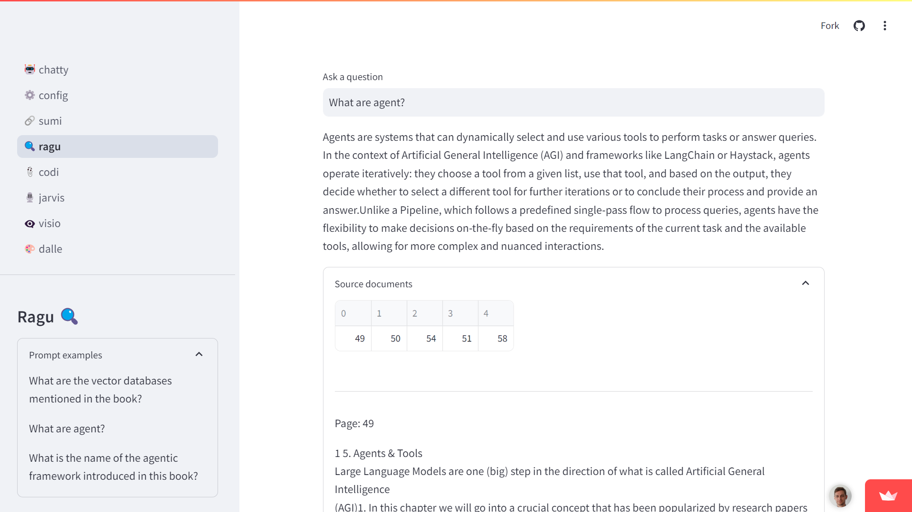

*Figure 9‑13 Retrieval to ground responses into the context of this book*

- 📎 codi:

This GPT is one of my favorites. It is less capable than the version described in chapter 5 that enables file inputs for advanced data analysis.

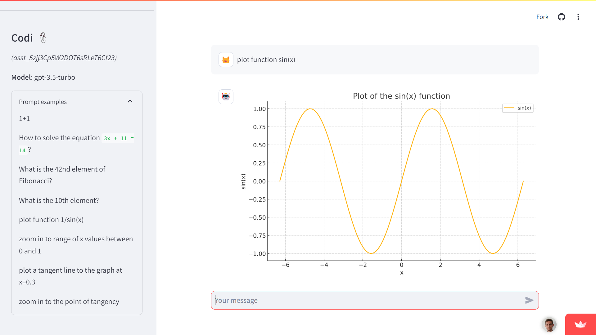

*Figure 9‑14 Codi is the new clippy to help you code*

- 🎙️jarvis:

This is probably the prototypical chatbot that most of us think about when building our own GPT. It’s a variation of chatty with added bells and whistles to take your voice as input. I didn’t go the extra mile of adding a voice synthesis of the bot response, as I was worried it would bring me to the “uncanny valley”. This expression represents the strange feeling that humans experience when an AI tries to mimic human functions but does not quite get it right (like when you have a weird looking human image generated).

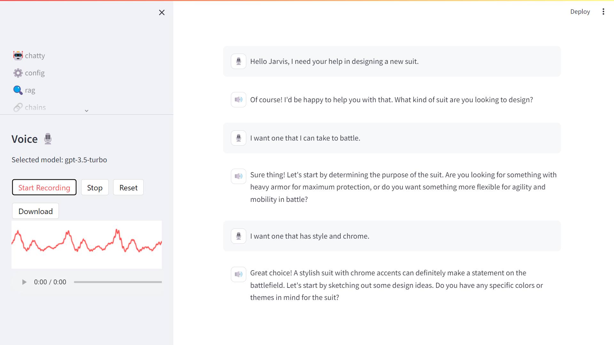

*Figure 9‑15 Voice is a transformative interface for AI*

- 👁️‍🗨️ visio:

This one sounds like a superhero name. And it does translate some of the feeling of being able to extract information from images. When this capability will scale to take video as input, it will open up a whole new dimension of copilot use cases.

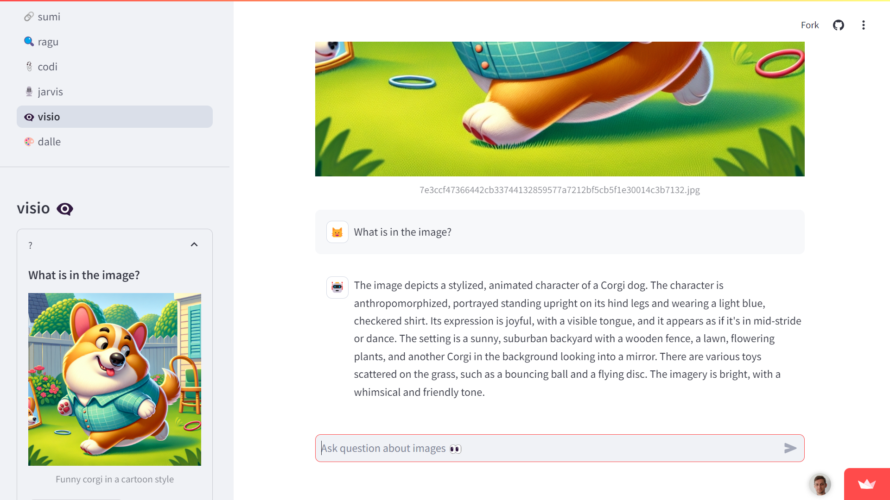

*Figure 9‑16 Vision for when you don't want to type*

- 🎨dalle:

This one is more artistic but can be useful for you to generate logos and images like the one on the cover of this book. If your application of AI is more for artwork or entertainment, this GPT is a good start.

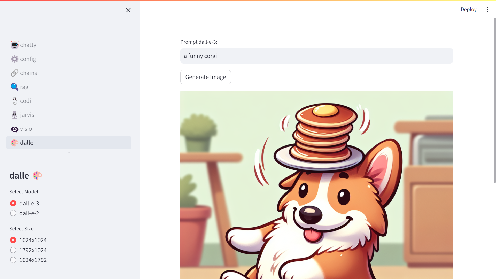

*Figure 9‑17 To reveal the artist in you*

[^1]:  <https://platform.openai.com/docs/actions/introduction>

[^2]:  Flask web framework: <https://flask.palletsprojects.com/>

[^3]:  Replit online development environment: <https://replit.com/>

[^4]:  Render hosting platform: <https://render.com/>

---

[⬅️ DALL-E image generation](8_DALL_E_image_generation.md) | [🏠 Home](README.md) | [Appendix ➡️](10_Appendix.md)
