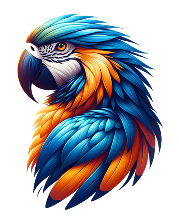

# Programming GPTs 🦜

Book available on Amazon 📖 
https://www.amazon.com/dp/B0DP76LL4D

## 📖 Read the book online

The full content of the book is available here, one page per chapter:

- [Preface](0_Preface.md)
    - Who is this book for
    - About the author
    - What you will learn
    - Setting up the Programming Environment
- [1. Introducing GPTs](1_Introducing_GPTs.md)
    - 1.1. Large Language Models Are Next-Word Predictors
    - 1.2. Generative Pretrained Transformers: Building Blocks of Language Intelligence
    - 1.3. Evolution of GPTs
    - 1.4. Building Your Own GPT
- [2. OpenAI APIs](2_OpenAI_APIs.md)
    - 2.1. Quick tour of the OpenAI developer platform
    - 2.2. Getting started with the chat completion API
    - 2.3. Prices of the API
    - 2.4. Build your first chatbot app
    - 2.5. Advanced parameters
- [3. Prompting, Chaining and Summarization](3_Prompting_Chaining_and_Summarization.md)
    - 3.1. The art of prompting
    - 3.2. Prompt engineering techniques in app development
    - 3.3. Why chaining
    - 3.4. Summarizing long documents
- [4. Vector search & Question Answering](4_Vector_search_Question_Answering.md)
    - 4.1. Map Rerank
    - 4.2. Retrieval-Augmented Generation
    - 4.3. Application: Question answering on Book
- [5. Agents & Tools](5_Agents_Tools.md)
    - 5.1. Agents select tools
    - 5.2. OpenAI Functions
    - 5.3. OpenAI Assistants
- [6. Speech-to-Text and Text-to-Speech](6_Speech_to_Text_and_Text_to_Speech.md)
    - 6.1. Transcription
    - 6.2. Voice synthesis
    - 6.3. Application: Daily tech podcast
- [7. Vision](7_Vision.md)
    - 7.1. From traditional computer vision to multi-modal language models
    - 7.2. Object detection
    - 7.3. From mock to web UI
    - 7.4. Video understanding
- [8. DALL-E image generation](8_DALL_E_image_generation.md)
    - 8.1. Generation
    - 8.2. Edits
    - 8.3. Variations
    - 8.4. Application: GPT Journey – choose your own adventure
- [9. Deploying GPTs](9_Deploying_GPTs.md)
    - 9.1. Deploy on the OpenAI GPT Store
    - 9.2. Deploy GPT Apps on Streamlit Cloud
- [10. Appendix](10_Appendix.md)
    - 10.1. More AI theory
    - 10.2. More LLMs: open-source and local alternatives
    - 10.3. More Applications
    - 10.4. More copilots

In this repo, you will learn how to program GPTs primarily leveraging OpenAI’s APIs. If you don’t know what an API is (Application Programming Interface), then this is not the repo you’re looking for. Go look it up on the internet, and come back after learning some basics of programming, preferably in Python, as this will be the language used for the tutorials in each chapter.
Generative Pre-Trained Transformers are quite complicated general-purpose machines that can do a lot of different things, like handling sequences of text, images, and sounds. You will learn the basic concepts and principles behind GPTs, and how they work under the hood. But more importantly, you will learn how to integrate them inside of your applications.

The repo is divided into 10 chapters, each covering a different topic and a different aspect of programming GPTs. The chapters are:
- **Chapter 1: 🤖 Introducing GPTs.** How they work and their evolution. 

- **Chapter 2: 🐱💬 OpenAI APIs.** In this chapter, you will learn how to use the OpenAI APIs, a simple way to create AI agents with GPT Models. You will start by learning how to create your own chatbot.

<video src="https://github.com/slevin48/openai/assets/12418115/91b2c4c6-7338-4f51-9440-16e59626378d" controls="controls" style="max-width: 730px;"></video>

- **Chapter 3: 🔗 Prompting, Chaining & Summarization.** In this chapter, you will learn how to engineer prompts, chain calls to a Large Language Model and use it to summarize texts, such as articles, books, or transcripts. You will use the OpenAI API together with the LangChain package to enhance GPTs.

<video src="https://user-images.githubusercontent.com/12418115/229315555-c9d2077a-a2ed-4538-816c-ce0b9cece761.webm" controls="controls" style="max-width: 730px;"></video>

- **Chapter 4: 🔎❓ Vector search & Question Answering.** In this chapter, you will learn how to use embeddings and vector search as a way to retrieve informative answers to answer questions while quoting sources. 

<video src="https://github.com/slevin48/openai/assets/12418115/b37ec63c-1a7d-4c81-a4b0-5f10f7ceb428" controls="controls" style="max-width: 730px;"></video>

- **Chapter 5: 🕵️‍♀️🛠️ Agent & Tools.** In this chapter, you will learn to build an Agent, called Smith, that has access to tools, such as getting the current weather. You will also learn how to use the Assistant API provided by OpenAI, and to extend their capabilities with tools to integrate GPTs with external services. This will be illustrated with the implementation of your own Code Interpreter, that can help you write and run code with GPTs.

<video src="https://github.com/slevin48/openai/assets/12418115/f8e0a3e6-50c9-4eb9-961f-177000a2d7f4" controls="controls" style="max-width: 730px;"></video>

- **Chapter 6: 🗣️📢 Text to Speech & Synthesis.** In this chapter, you will learn how to use GPTs to transcript text from speech (such as Youtube videos), and synthetize speech from text (such as articles). 

<video src="https://github.com/slevin48/ami/assets/12418115/6d12b2dd-b349-48be-bdf9-4efafae4e0bf" controls="controls" style="max-width: 730px;"></video>

- **Chapter 7: 👀 Vision API.** In this chapter, you will learn how to use GPTs to process and analyze images, such as mock-ups or drawings. You will learn how to use the Vision API, to perform various tasks with GPTs, such as text recognition, or video captioning.

<video src="https://github.com/slevin48/openai/assets/12418115/1a83c37c-b105-42cf-b2d7-b25656824e13" controls="controls" style="max-width: 730px;"></video>

- **Chapter 8: 🎨🖌️ Dall-E image generation.** In this chapter, you will learn how to use Dall-E 2 & 3, which can create stunning and creative images from any text input. You will also learn how to use the outpainting, inpainting and variations APIs, which can complete or modify existing images.

<video src="https://github.com/slevin48/openai/assets/12418115/3726aa2c-67e0-474c-909f-5cb54eaa39db" controls="controls" style="max-width: 730px;"></video>

- **Chapter 9: 📌 Deploying GPTs.** In this chapter, you will reuse what you have learned, and you will deploy your own GPTs. This will be made concrete with a small team of GPTs covering each one chapter of the book.

<video src="https://github.com/user-attachments/assets/b972e931-9412-4561-a578-5fb83cf78398" controls="controls" style="max-width: 730px;"></video>

- **Chapter 10: 📚 Appendix.** In this chapter, you will find additional resources to keep up with the latest developments and innovations in the field of GPTs.

<video src="https://github.com/user-attachments/assets/f1cd1721-7440-4a14-b8f5-0527fa18afce" controls="controls" style="max-width: 730px;"></video>
